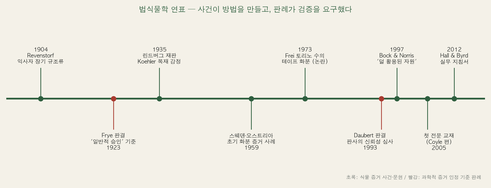
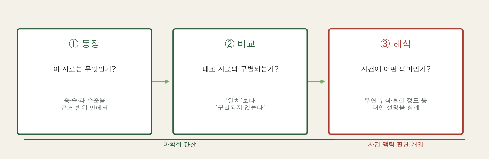

범죄 현장은 대부분 야외이거나 야외와 이어져 있습니다. 사람은 그곳을 드나들면서 반드시 무언가를 묻혀 나옵니다. 신발 바닥의 흙, 바짓단에 걸린 씨앗, 옷 섬유 사이에 낀 꽃가루가 그렇습니다. 그리고 우리가 먹는 음식 대부분이 식물이니, 위 내용물에서도 식물 조직이 나옵니다. **식물은 현장에 가장 흔하게 남는 흔적**입니다.

이 글은 법식물학 강의 1주차 내용을 바탕으로, 관련 문헌과 사례를 추가로 조사해 정리한 스터디 노트입니다. 1주차는 이 분야가 무엇이고, 어떤 사건을 거치며 자리를 잡았으며, 식물 증거가 법정에서 받아들여지려면 무엇이 필요한지를 다룹니다.

## 왜 식물인가

강의록은 식물 증거가 수사에 쓸모 있는 이유를 네 가지로 정리합니다.

- **흔하다.** 현장, 사람, 물건 어디에서나 식물 조각이 나옵니다.
- **특징적이다.** 잎 표피 세포, 털(모용), 기공, 결정 같은 구조가 종마다 달라 작은 조각으로도 동정할 수 있습니다.
- **잘 남는다.** 셀룰로스·리그닌으로 된 세포벽과 꽃가루의 바깥 벽은 분해와 소화에 강합니다.
- **시공간 정보를 담는다.** 식물은 자라는 장소와 피는 시기가 정해져 있습니다.

2023년 Science & Justice에 실린 개관 논문(Kasprzyk, 2023)도 비슷하게 정리합니다. 식물은 어디에나 있고, 대조 시료를 확보하기 쉽고, 환경 변화에 민감하다는 것입니다. 같은 논문은 식물 증거의 쓰임을 용의자·물건과 현장의 연결, 알리바이 확인, 사후 경과 시간 추정, 식품이나 물건의 원산지 판별로 나누고, **대부분 정황 증거로 쓰인다**고 짚습니다.

## 법식물학의 정의와 범위

법식물학(forensic botany)은 식물과 식물 유래 물질(강의에서는 조류와 균류도 포함)에 관한 지식을 법적 질문에 적용하는 응용 분야입니다. 강의록이 강조하는 점은 이것이 식물학 안의 독립 분과라기보다 **학제적 묶음**이라는 것입니다. Miller Coyle 등(2001)도 법식물학의 하위 분야로 식물 해부학, 식물 생태학, 식물 계통분류학, 분자생물학, 화분학, 육수학을 나열합니다.

이 강의는 다루는 증거에 따라 범위를 나눕니다.

| 분야 | 주된 대상 | 답하려는 질문 |
|---|---|---|
| 형태·해부 감정 | 잎, 줄기, 목재, 종자 조각 | 이 조각은 무엇이고, 두 시료는 같은 출처인가 |
| 현장 식생 | 꺾인 식물, 매장지 뿌리 | 이 장소는 언제 어떻게 교란되었나 |
| 법화분학 | 꽃가루, 포자 | 이 사람이나 물건은 어느 장소와 관련 있나 |
| 규조류·수생식물 | 규조류, 조류 | 익사인가, 어느 물에서 일어났나 |
| 위 내용물 | 위·장 속 식물 조직 | 마지막으로 무엇을 먹었나 |
| 독성 식물 | 독초, 독버섯, 잔사 | 어떤 독성 식물이고 어떤 성분이 나오나 |

DNA 바코딩 같은 분자 분석도 이 분야의 한 축이지만, 이 강의는 형태·해부학적 동정에 집중하고 DNA는 다루지 않습니다.

법식물학은 혼자보다 다른 분야와 함께 쓰일 때 힘을 냅니다. 사후 경과 시간을 예로 들면, 곤충 증거는 짧은 기간을 정밀하게 알려주고, 매장지 뿌리의 생장이나 식생 재생 같은 식물 증거는 더 긴 기간의 단서를 줍니다. 위 내용물에서 독성 식물이 의심되면 법독성학자가 성분을, 법식물학자가 조직의 종류를 분석해 서로 교차 확인합니다.

## 역사: 사건이 방법을 만들었다

_법식물학의 주요 사건과 문헌, 그리고 과학적 증거의 인정 기준을 바꾼 미국 판례를 시간 순으로 놓았습니다._

### 규조류: 익사 판단의 오래된 도구

20세기 초 독일의 Revenstorf가 익사자의 장기에서 규조류를 찾는 방법을 제안한 것(흔히 1904년으로 인용)이 출발점으로 소개됩니다. 규조류는 규산질 껍질을 가진 단세포 조류라 산으로 조직을 녹여도 남습니다. 살아서 물을 들이마시면 규조류가 폐를 지나 혈류를 타고 먼 장기까지 간다는 논리입니다.

이 검사는 지금도 쓰입니다. 2006년 리뷰(Piette & De Letter)는 규조류 검사를 여전히 익사 진단의 "golden standard"로 부르면서도, 결정적인 단일 검사는 아직 없고 **부검 소견과 규조류 검사의 조합이 현실적인 타협**이라고 결론짓습니다. 2020년 리뷰(Zhou 등)는 규조류가 어디에나 있어서 위양성이, 과도한 산 처리로 위음성이 생길 수 있다고 정리합니다. 7주차에 자세히 다룹니다.

### 린드버그 사건: 사다리가 증인이 되다

법식물학 교과서가 가장 먼저 꺼내는 사건입니다. 1932년 비행사 찰스 린드버그의 아기가 유괴되었고, 범인은 집 앞에 손으로 만든 나무 사다리를 남겼습니다.

미국 산림청 사료 단체인 Forest History Society의 정리에 따르면, 1933년 뉴저지 주경찰의 요청이 산림청을 거쳐 위스콘신주 매디슨의 **임산물연구소(Forest Products Laboratory)**로 넘어갔고, 수석 목재기술자 **Arthur Koehler**가 감정을 맡았습니다. Koehler는 레일에 남은 대패 자국에서 칼날 수와 이송 속도를 읽어내고, 이를 제재소들의 기계와 출하 기록에 맞춰 보았습니다. 그렇게 사우스캐롤라이나의 한 제재소를 거쳐 뉴욕 브롱크스의 목재상까지 추적했는데, 이곳은 뒤에 체포된 Bruno Richard Hauptmann이 목재를 산 곳이었습니다.

결정적인 것은 **16번 레일**이었습니다. 이 레일은 Hauptmann 집 다락의 잘려 나간 마루판과 나이테의 곡률·개수·폭이 이어졌고, 레일의 사각 못구멍 네 개는 다락 장선의 못 자리와 정확히 맞았습니다. 1935년 재판에서 Koehler는 이 비교를 배심원에게 직접 보여주었고, 같은 해 2월 13일 유죄 평결이 나왔습니다. Koehler는 1937년 Journal of Criminal Law and Criminology에 감정 기법을 정리한 논문을 남겼습니다.

> 이 사건의 유무죄 자체는 지금도 역사학자와 법률가 사이에 논쟁이 있습니다. 법식물학에서 이 사건을 배우는 이유는 판결이 옳았느냐가 아니라, **목재 해부학적 비교가 어떤 단계로 이루어졌고 어디까지 말할 수 있었는가**를 보기 위해서입니다.
{: .prompt-info }

### 법화분학: 1959년의 두 사건

꽃가루는 지름이 수십 마이크로미터라 옷이나 신발에 묻어도 본인이 모릅니다. Texas A&M의 화분학자 Vaughn Bryant가 2009년에 발표한 슬라이드는 "알려진 가장 이른 사용"으로 **1959년의 두 사건**을 듭니다.

- **스웨덴**: 살해된 여성의 옷에서 씻어낸 흙의 화분이 시신 발견 장소의 대조 시료와 맞지 않았고, 경찰은 다른 장소에서 살해된 것으로 판단했습니다.
- **오스트리아**: 다뉴브강 유람선에서 한 승객이 사라졌습니다. 동행한 사업 동료의 등산화 진흙에서 빈 대학의 Wilhelm Klaus가 현생 가문비·버드나무·오리나무 화분과 함께 약 2천만 년 전(마이오세) 히코리의 화석 화분을 찾았습니다. 그 지층이 드러난 지점은 강변에 한 곳뿐이었고, 용의자는 자백한 뒤 그 부근의 시신 위치를 알려주었습니다.

강의록은 오스트리아 사건을 "첫 사례로 자주 소개된다"고 쓰는데, 스웨덴 사건도 같은 해 기록으로 함께 거론된다는 점을 덧붙여 둡니다.

### Max Frei: 방법보다 해석이 문제였던 사례

스위스 취리히 경찰의 범죄학자 Max Frei는 접착테이프로 미세 흔적을 떼어내는 방법으로 알려져 있습니다. 그런데 그의 이름이 가장 널리 알려진 것은 1970년대 **토리노 수의**의 화분 분석입니다. Bryant의 정리에 따르면 Frei는 테이프로 떼어낸 화분 대부분을 광학현미경만으로 종 수준까지 동정했고, 그 조합이 예루살렘 지역에만 있다고 주장했지만 **그 지역의 토양 대조 시료는 조사하지 않았습니다.** 강의록이 이 사례를 증거 연속성과 대조 시료의 중요성을 보여주는 교훈으로 쓰는 이유입니다.

### 학문으로 자리 잡다

1997년 Bock과 Norris는 Journal of Forensic Sciences에 "법식물학, 덜 활용된 자원"이라는 논문을 냈습니다. 수사 인력에게 식물학 지식이 부족해 식물 증거가 제대로 쓰이지 않는다는 지적이었고, 위 내용물로 마지막 식사의 내용과 장소를 추정하는 데 쓸 수 있다고 제안했습니다. 2006년 Forensic Science International은 법화분학 특집을 묶었는데, 여기서 Bryant와 Jones는 미국이 식생이 매우 다양해 화분 분석에 이상적인 곳인데도 정보·전문가·교육기관이 없어 "가장 덜 활용되는 기법"으로 남아 있다고 썼습니다.

같은 특집에 실린 뉴질랜드 Dallas Mildenhall의 사례가 인상적입니다. 침입자가 집 뒷문 옆에 꽃이 핀 하이페리쿰 덤불을 스쳤고, 용의자 옷의 하이페리쿰 화분이 그 덤불과 연결되었습니다. 그런데 Mildenhall은 같은 논문에서 화분 증거는 본질적으로 정황 증거여서 **그것만으로 유죄를 입증하기 어렵다**고 분명히 적었습니다.

교재도 이 시기에 나왔습니다. Heather Miller Coyle이 엮은 *Forensic Botany: Principles and Applications to Criminal Casework*(CRC Press, 2005), Hall과 Byrd가 엮은 *Forensic Botany: A Practical Guide*(Wiley-Blackwell, 2012), Bock과 Norris의 *Forensic Plant Science*(Elsevier, 2016)가 지금 강의의 뼈대입니다.

### 한국의 맥락

국내에서는 국립과학수사연구원과 경찰 과학수사 조직이 위 내용물, 독버섯, 독초 중독 사건의 감정을 맡아 왔습니다. 독성 식물 감정 수요가 특히 큰 이유는 오인 섭취 사고가 해마다 나기 때문입니다. 식약처와 국립수목원은 2023년 봄, 2020년 이후 신고된 독초 오인 섭취 26건 중 85%가 3~6월에 몰렸다며 동의나물과 곰취, 여로와 원추리처럼 헷갈리기 쉬운 쌍을 경고했습니다.

참고로 국과수 연구진은 비닐하우스 방울토마토 훼손 사건에서 용의자 옷과 낫의 식물 얼룩을 엽록체 DNA로 식별한 사례를 한국법과학회지에 보고하기도 했습니다(이은정 등, 2018). 이 강의의 범위는 아니지만, 형태로 판단하기 어려운 얼룩에는 이런 방법도 있다는 정도로 알아 둡니다.

## 법정 증거로서의 식물

### 증거 연속성

아무리 정확한 감정이라도 시료가 어디서 어떻게 채취되어 어떤 경로로 감정인에게 왔는지 증명되지 않으면 가치가 크게 떨어집니다. **증거 연속성(chain of custody)**은 채취부터 법정까지 모든 취급 단계를 기록해 시료가 같은 것이고 훼손되지 않았음을 보이는 절차입니다. 식물 시료는 마르거나 곰팡이가 피고, 화분은 공기 중 오염에 약해서 특히 신경 써야 합니다. 채취 좌표, 일시, 채취자, 포장, 보관 조건, 인계 기록을 빠짐없이 남깁니다.

### 감정인의 자세

감정인은 어느 편을 드는 사람이 아니라 법원이 사실을 판단하도록 돕는 사람입니다. 강의록은 네 가지를 듭니다. 의뢰인의 기대와 무관하게 결론 내기, 사건 정보에서 오는 확증편향을 경계하고 가능하면 맹검으로 비교하기, 동정 수준과 확신도를 근거 범위 안에서만 쓰기, 사망 시각이나 치사량처럼 전문 밖의 질문은 넘기기입니다. 표현도 "일치한다"보다 **"구별되지 않는다"**, "일관된다"처럼 증거가 뒷받침하는 만큼만 씁니다.

### 과학적 증거의 인정 기준

미국에서는 1923년 **Frye 판결**이 기준이 되었습니다. 수축기 혈압으로 거짓말을 판별한다는 검사 결과를 증거로 내려 했는데, 법원은 그 원리가 해당 분야에서 **일반적 승인(general acceptance)**을 얻지 못했다며 받아들이지 않았습니다.

1993년 **Daubert 판결**에서 연방대법원은 연방증거규칙 702조가 Frye 기준을 대체했다고 보고, 판사가 전문가 증언의 신뢰성과 관련성을 직접 따지도록 했습니다. 판결이 예시한 고려 요소는 다섯 가지입니다.

1. 이론이나 기법이 검증될 수 있고, 실제로 검증되었는가
2. 동료 평가를 거쳐 출판되었는가
3. 알려진 또는 잠재적 오차율은 얼마인가
4. 운영을 통제하는 표준이 있고 유지되는가
5. 관련 학계에서 널리 받아들여지는가

판결은 이것이 확정 체크리스트는 아니라고 밝혔지만, 법식물학의 동정·비교 방법을 점검하는 틀로 그대로 쓸 수 있습니다. 특히 3번 오차율은 형태 동정이 가장 약한 지점입니다.

한국 형사소송법은 법원이 "학식 경험있는 자"에게 감정을 명할 수 있다고 정하고(제169조), 증거의 증명력은 법관의 자유판단에 맡깁니다(제308조). 감정 결과는 다른 증거와 함께 법관의 심증 안에서 평가됩니다.

### 동정, 비교, 해석을 나눠서 생각하기

_동정과 비교는 관찰의 영역이고, 해석에는 사건 맥락에 대한 판단이 들어갑니다._

과대 해석은 대개 세 번째 단계에서 생깁니다. "용의자 신발의 화분이 현장 화분과 구별되지 않는다"는 관찰과 "용의자가 현장에 있었다"는 해석 사이에는 그 식물이 그 지역에 얼마나 흔한지, 다른 경로로 묻었을 가능성은 없는지 같은 질문이 놓여 있습니다. 감정서에는 이 대안 설명을 함께 적어야 합니다.

## 한계와 과대 해석 주의

> 식물 증거는 **범인을 지목하는 증거가 아니라 가능성의 범위를 좁히는 증거**입니다. 성공 사례로 꼽히는 린드버그 사건도, 하이페리쿰 화분 사건도 식물 증거는 다른 증거와 함께 쓰였습니다.
{: .prompt-warning }

강의록의 강점·한계 표를 짝지어 보면 강점이 곧 약점이기도 합니다.

| 강점 | 뒤집으면 |
|---|---|
| 어디에나 흔하다 | 우연히 묻었을 가능성도 크다 |
| 종마다 구조가 특징적이다 | 조각이 작거나 소화·가열되면 종까지 못 간다 |
| 화분 외벽은 잘 남는다 | 그만큼 환경 오염도 잘 남는다 |
| 장소·계절 정보를 준다 | 개인을 특정하지는 못한다 |
| 현미경만으로 분석된다 | 전문가와 지역 참고 표본이 부족하다 |

형태 동정이 틀릴 수 있다는 국내 자료도 있습니다. 국과수 연구진이 형태학적으로 독버섯으로 분류되어 있던 표본 51점을 DNA로 다시 확인했더니 9점이 다른 종이었고, 그중 1점은 독버섯이 아닌 식용·약용 버섯이었습니다(김주영 등, 2020). 이 결과는 형태 동정을 버리자는 뜻이 아니라, Daubert가 묻는 **오차율과 표준**을 형태 감정도 스스로 제시할 수 있어야 한다는 뜻으로 읽힙니다.

역사의 교훈도 같은 방향입니다. 규조류 검사와 Frei의 사례처럼 초기에 널리 쓰인 방법도 오염과 해석의 문제로 다시 평가받았습니다. 방법을 먼저 검증하고, 증거 하나로 결론 내리지 않고, 식물학자와 수사관이 서로의 질문과 한계를 이해해야 합니다.

## 정리

> - 법식물학은 해부학·분류학·화분학·생태학을 법적 질문에 맞게 묶은 **학제 분야**입니다.
> - 규조류(1904), 린드버그 사다리(1935 재판), 1959년 화분 사건처럼 **사건이 방법을 만들었고**, 1997년 Bock & Norris 이후 교재와 교육 체계가 갖춰졌습니다.
> - 법정에서 통하려면 **증거 연속성, 감정인의 객관성, 방법의 타당성**(Frye → Daubert)이 필요합니다.
> - 분석은 **동정 → 비교 → 해석**으로 나누고, 해석 단계에서 대안 설명을 함께 씁니다.
{: .prompt-tip }

다음 주부터는 이 증거들을 실제로 읽어내기 위한 기초, 식물의 형태와 해부 구조로 들어갑니다.

## 참고문헌

- 법식물학 1주차 강의록, 「법식물학 개론과 역사」.
- Bock, J. H. & Norris, D. O. (1997). Forensic botany: an under-utilized resource. *Journal of Forensic Sciences*, 42(3), 364–367. [NCJRS 초록](https://ojp.gov/ncjrs/virtual-library/abstracts/forensic-botany-under-utilized-resource)
- Bock, J. H. & Norris, D. O. (2016). *Forensic Plant Science*. Elsevier. [출판사](https://shop.elsevier.com/books/forensic-plant-science/bock/978-0-12-801475-2)
- Bryant, V. M. (2009). Forensic palynology (발표 슬라이드). FIU Global Forensic and Justice Center 아카이브. [PDF](https://archive.gfjc.fiu.edu/trace/2009/presentations/3-bryant-palynology1.pdf)
- Bryant, V. M. & Jones, G. D. (2006). Forensic palynology: current status of a rarely used technique in the United States of America. *Forensic Science International*, 163(3), 183–197. [PubMed](https://pubmed.ncbi.nlm.nih.gov/16504436/)
- Coyle, H. M. (Ed.) (2005). *Forensic Botany: Principles and Applications to Criminal Casework*. CRC Press.
- Daubert v. Merrell Dow Pharmaceuticals, Inc., 509 U.S. 579 (1993). [Cornell LII](https://www.law.cornell.edu/supremecourt/text/509/579)
- Forest History Society. CSI Madison, Wisconsin: Wooden Witness. [링크](https://foresthistory.org/?p=7919)
- Frye v. United States, 293 F. 1013 (D.C. Cir. 1923).
- Hall, D. W. & Byrd, J. H. (Eds.) (2012). *Forensic Botany: A Practical Guide*. Wiley-Blackwell.
- Kasprzyk, I. (2023). Forensic botany: who?, how?, where?, when? *Science & Justice*, 63(2), 258–275. [PubMed](https://pubmed.ncbi.nlm.nih.gov/36870705/)
- Koehler, A. (1937). Techniques used in tracing the Lindbergh kidnaping ladder. *Journal of Criminal Law and Criminology*, 27(5), 712. [Northwestern](https://scholarlycommons.law.northwestern.edu/jclc/vol27/iss5/9)
- Mildenhall, D. C. (2006). Hypericum pollen determines the presence of burglars at the scene of a crime. *Forensic Science International*, 163(3), 231–235. [PubMed](https://pubmed.ncbi.nlm.nih.gov/16406430/)
- Mildenhall, D. C., Wiltshire, P. E. J. & Bryant, V. M. (2006). Forensic palynology: why do it and how it works. *Forensic Science International*, 163(3), 163–172. [PubMed](https://pubmed.ncbi.nlm.nih.gov/16920303/)
- Miller Coyle, H., Ladd, C., Palmbach, T. & Lee, H. C. (2001). The Green Revolution: botanical contributions to forensics and drug enforcement. *Croatian Medical Journal*, 42(3), 340–345. [PubMed](https://pubmed.ncbi.nlm.nih.gov/11387649/)
- Piette, M. H. & De Letter, E. A. (2006). Drowning: still a difficult autopsy diagnosis. *Forensic Science International*, 163(1–2), 1–9. [PubMed](https://pubmed.ncbi.nlm.nih.gov/16378701/)
- Texas A&M College of Arts & Sciences (2020). A silent witness: how analysis of pollen can solve crimes. [링크](https://liberalarts.tamu.edu/blog/a-silent-witness-how-analysis-of-pollen-can-solve-crimes/)
- Zhou, Y. 외 (2020). Research advances in forensic diatom testing. *Forensic Sciences Research*, 5(2), 98–105. [PMC](https://pmc.ncbi.nlm.nih.gov/articles/PMC7476611/)
- 김주영 외 (2020). DNA 바코드 마커를 이용한 독버섯의 분자유전학적 종식별 연구. 한국법과학회지, 21(1), 1–8. [earticle](https://www.earticle.net/Article/A388900)
- 이은정 외 (2018). 재물손괴 사건 규명을 위한 용의자 의복에 묻은 식물 얼룩의 종 식별. 한국법과학회지, 19(1), 36–42. [earticle](https://m.earticle.net/Article/A342534)
- 식품의약품안전처·국립수목원 (2023. 4. 14.) 봄철 독초 오인 섭취 주의 (아시아경제 보도). [링크](https://www.asiae.co.kr/en/article/2023041410051331441)
- 형사소송법 제169조(감정), 제308조(자유심증주의).

[발표자료 (PPTX) 내려받기](/assets/files/forensic-botany/forensic-botany-week01.pptx)

---

**법식물학 스터디** · [2주차 식물 형태학 기초](/posts/forensic-botany-02-plant-morphology/) →
