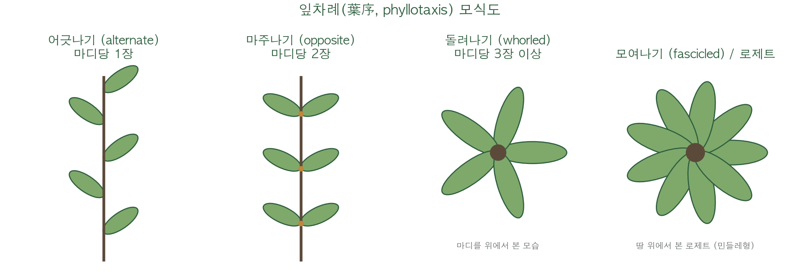
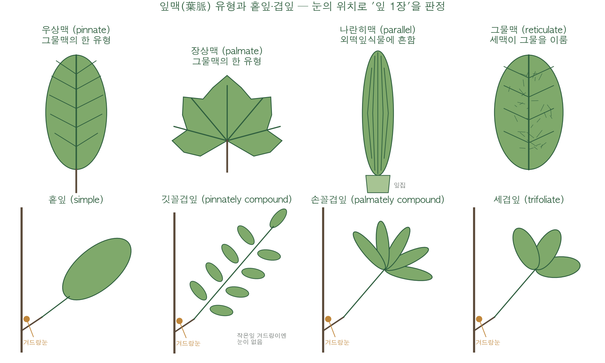
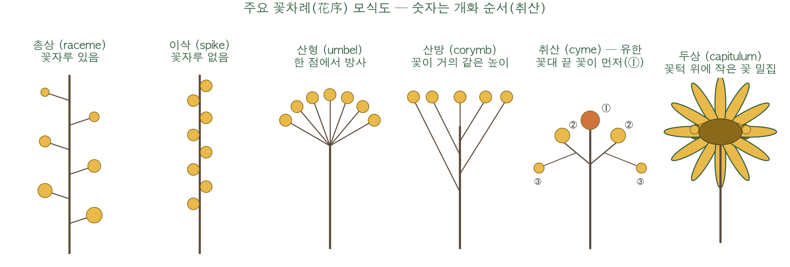

신발 밑창에 낀 잎 조각 하나, 차량 매트에 붙은 열매 하나가 사건을 풀 실마리가 될 수 있을까요? 될 수 있습니다. 다만 조건이 있습니다. 그 조각을 **다른 전문가도 같은 결론에 이를 수 있는 말**로 기록해야 합니다. "잎이 둥글다"는 관찰 메모는 증거가 되기 어렵습니다. "잎몸은 신장형이고 밑은 심장형이다"라고 써야 다른 사람이 확인하거나 반박할 수 있습니다.

이 글은 법식물학 강의 2주차 내용을 바탕으로, 관련 문헌과 사례를 추가로 조사해 정리한 스터디 노트입니다. 2주차 주제는 식물의 **외부 형태**입니다. 뿌리·줄기·잎·꽃·열매·종자를 차례로 보고, 형태 용어를 어떻게 정확히 쓰는지, 단편 시료에서 무엇을 말할 수 있고 무엇은 말할 수 없는지를 정리합니다.

## 왜 형태학이 출발점인가

법식물학에서 가장 먼저 하는 일은 시료를 **보고 기록하는 것**입니다. 현미경 검사나 화학 분석은 비용이 들고 시료를 소모하기도 합니다. 그래서 먼저 육안과 확대경으로 시료가 어떤 기관(잎인지, 줄기인지, 종자인지)이고 어떤 상태인지 파악한 다음에 다음 검사를 정합니다.

현장 시료는 교과서 표본과 거리가 멉니다. 대부분 부서지고, 마르고, 일부만 남아 있습니다. 그래서 이번 주의 목표는 용어를 외우는 데서 끝나지 않습니다. **어떤 기관의 어떤 형질이 동정에 쓸모 있는지**, 그리고 **단편에서 확인할 수 없는 것은 무엇인지**를 판단하는 감각을 기르는 것입니다.

중독 사건도 같은 이유로 형태학이 중요합니다. 국내에서 보고된 식물 중독 상당수는 식용 식물로 **오인**한 데서 시작합니다. 예를 들어 성인 남성 4명이 자리공 뿌리를 인삼으로 알고 먹은 뒤 구역과 구토로 응급실을 찾은 증례가 보고되어 있습니다(배준호 외, 2013). 이런 오인을 가려내는 기준은 결국 잎의 배열, 잎맥, 털, 뿌리의 모양 같은 외부 형태입니다.

> 의료영상에 비유하면, 형태 기재는 판독문의 "소견(findings)" 부분입니다. 소견과 결론(impression)을 분리해야 다른 판독의가 같은 영상을 보고 검증할 수 있습니다. 법식물학의 기재문도 같은 구조입니다.
{: .prompt-info }

## 용어는 누가 정하나: 국문·영문 표준

식물 형태 용어가 어려운 가장 큰 이유는 같은 대상을 여러 말로 부른다는 점입니다. 영어를 한자어로 옮긴 말, 한자음을 그대로 적은 말, 우리말로 다듬은 말이 함께 쓰입니다. 국립수목원은 2010년 「알기 쉽게 정리한 식물용어」를 펴내면서 바로 이 점을 문제로 꼽았습니다. 이 책은 교과서 등 22권의 문헌을 바탕으로 외부 형태를 묘사하는 용어를 정리해 **권장용어 646개**를 실었습니다. 각 용어에 국어·영어·한자어를 함께 적고, 혼동을 막기 위해 그림과 유사용어도 넣었습니다(국립수목원 보도자료, 2010).

영문으로는 Kew 식물원이 펴낸 *The Kew Plant Glossary*(Beentje, 2016, 2판)가 대표적입니다. 약 4,900개 용어를 그림과 함께 정리한 사전으로, 식물 기재문과 검색표를 쓰는 사람을 대상으로 합니다. 강의록이 인용한 Harris & Harris(2001)의 도해 용어집도 같은 성격입니다.

학명과 국명(우리 이름)은 별도로 **국가표준식물목록**이 기준을 제공합니다. 국립수목원과 한국식물분류학회가 함께 검토해 표준 학명과 추천 국명을 정합니다. 감정서에 "○○나무"라고 쓸 때도 이 목록의 이름과 학명을 함께 적는 것이 안전합니다.

## 큰 틀: 외떡잎식물과 진정쌍떡잎식물

법식물학에서 다루는 식물은 대부분 종자식물입니다. 종자식물은 밑씨가 드러난 **겉씨식물**(소나무, 은행나무)과 밑씨가 씨방에 싸인 **속씨식물**로 나뉩니다. 속씨식물은 전통적으로 떡잎 수에 따라 외떡잎식물과 쌍떡잎식물로 나눴습니다.

그런데 분자계통학을 반영한 APG IV 체계(Angiosperm Phylogeny Group, 2016)에서는 '쌍떡잎식물'이 하나의 계통군이 아님이 드러났습니다. 대부분은 **진정쌍떡잎류(eudicots)**라는 단계통군에 속하고, 나머지는 기초 속씨식물과 목련군으로 흩어집니다. 진정쌍떡잎류를 묶는 대표 형질은 화분에 발아구가 세 개 있는 **삼구형(tricolpate)** 화분입니다.

| 형질 | 외떡잎식물 (벼과, 백합과) | 진정쌍떡잎식물 (장미과, 국화과) |
|---|---|---|
| 떡잎 | 1장 | 2장 |
| 잎맥 | 나란히맥이 흔함 | 그물맥이 흔함 |
| 꽃 기본수 | 3의 배수 | 4 또는 5의 배수 |
| 뿌리 | 수염뿌리 | 원뿌리 + 곁뿌리 |
| 줄기 관다발 | 흩어져 있음 | 고리 모양 |
| 화분 발아구 | 대체로 1개 (단구형) | 대체로 3개 (삼구형) |

이 표는 **경향**일 뿐입니다. 천남성과는 외떡잎식물인데도 잎맥이 그물 모양이고, 질경이는 진정쌍떡잎식물인데도 잎맥이 나란합니다. 그래서 형질 하나로 판단하지 않고 여러 형질을 함께 봐야 합니다. 이 원칙은 동정 전체에 적용됩니다.

## 뿌리와 줄기: 마디가 있느냐 없느냐

**뿌리**에는 원뿌리와 곁뿌리, 수염뿌리, 줄기에서 나는 부정근, 양분을 저장한 저장뿌리(무, 고구마)가 있습니다. **줄기**에서 가장 중요한 구조는 잎이 붙는 자리인 **마디(node)**와 잎겨드랑이의 **겨드랑눈**입니다. 잎이 없는 겨울 나무는 눈의 배열, 껍질눈, 수피 질감으로 동정합니다.

땅속에서 비대해진 줄기는 뿌리로 오인되기 쉽습니다. 감자(덩이줄기), 양파(비늘줄기), 연근(뿌리줄기), 토란(구경)이 모두 줄기입니다. 기본 구별 기준은 단순합니다. **줄기에는 마디와 눈이 있고 뿌리에는 없습니다.** 감자의 '눈'이 바로 그 증거입니다. 마디가 흐릿한 경우도 있으니 3주차에 다룰 단면 내부 구조로 보완합니다.

뿌리는 사후경과시간 추정에도 쓰였습니다. 포르투갈 북부 숲에서 발견된 백골 유해에는 이끼와 관목 뿌리가 뼈를 관통해 자라 있었습니다. 연구진은 그 생장 정도로 **최소 3년**이 지났다고 추정했고, 이는 실종 기간 6년과 모순되지 않았습니다(Cardoso et al., 2010).

## 잎: 가장 많이, 가장 자주 쓰이는 기관

잎은 가장 흔히 발견되고 형태 변이도 풍부해서 동정에 가장 널리 쓰입니다. 잎의 형질은 **배열 → 구성 → 모양 → 가장자리 → 잎맥 → 표면** 순서로 기록하면 빠뜨리는 것이 줄어듭니다.

### 잎차례

_줄기에 잎이 붙는 네 가지 방식. 직접 그린 모식도입니다._

마디마다 잎이 한 장이면 **어긋나기**, 두 장이 마주 붙으면 **마주나기**, 세 장 이상이면 **돌려나기**입니다. 짧은 줄기에서 잎이 모여 나면 **모여나기**라고 하고, 민들레처럼 뿌리잎이 땅에 방사상으로 퍼진 모양은 **로제트**라고 부릅니다. 잎차례는 잎이 줄기에 붙은 채로 있어야 볼 수 있습니다. 잎 조각만 남은 시료에서는 알 수 없는 형질이라는 점을 기억해야 합니다.

### 홑잎과 겹잎, 그리고 겨드랑눈

_위: 잎맥 유형. 아래: 홑잎과 세 가지 겹잎. 겨드랑눈(주황색)은 잎 전체의 밑에만 있습니다._

잎몸이 하나로 이어져 있으면 **홑잎**, 여러 장의 작은잎(leaflet)으로 나뉘어 있으면 **겹잎**입니다. 겹잎에는 깃꼴겹잎, 손꼴겹잎, 세겹잎이 있습니다. 초심자가 가장 많이 하는 실수는 **작은잎 하나를 잎 한 장으로 보는 것**입니다. 판정 기준은 겨드랑눈의 위치입니다. 겨드랑눈은 잎 전체의 잎자루 밑에만 있고 작은잎의 밑에는 없습니다.

### 모양·가장자리·잎맥 용어 대응표

| 항목 | 국문 (한자) | 영문 |
|---|---|---|
| 전체 모양 | 선형, 피침형(披針形), 난형(卵形), 도란형, 타원형, 심장형, 신장형(腎臟形) | linear, lanceolate, ovate, obovate, elliptic, cordate, reniform |
| 끝 | 예두(銳頭), 둔두, 점첨두(漸尖頭), 미두, 요두 | acute, obtuse, acuminate, caudate, retuse |
| 밑 | 쐐기형, 둥근형, 심장형, 귀 모양, 비대칭 | cuneate, rounded, cordate, auriculate, oblique |
| 가장자리 | 전연(全緣), 톱니, 겹톱니, 둔거치, 결각, 파상 | entire, serrate, doubly serrate, crenate, lobed, undulate |
| 잎맥 | 그물맥(우상맥·장상맥), 나란히맥 | reticulate (pinnate, palmate), parallel |
| 표면·질감 | 털, 가죽질, 종이질, 막질, 선점, 분백색 | trichome, coriaceous, chartaceous, membranaceous, gland dot, glaucous |

같은 식물에서도 잎은 다양합니다. 어린 잎과 성숙한 잎, 햇빛을 받은 양엽과 그늘의 음엽은 크기와 모양이 다르고, 한 개체에 모양이 다른 잎이 달리는 **이형엽성**을 보이는 식물도 있습니다. 그러므로 가능하면 여러 장을 관찰하고 **변이 범위**를 기록합니다.

> 대마(손꼴겹잎, 가장자리에 톱니가 있는 가늘고 긴 작은잎)나 아편양귀비(분백색의 깊이 갈라진 잎이 줄기를 감싸고, 삭과 꼭대기에 방사상의 주두가 남음)는 육안 단서가 비교적 뚜렷합니다. 그래도 비슷한 식물이 많아 육안 소견만으로 결론을 내리지 않고 현미경·화학 검사를 함께 합니다.
{: .prompt-warning }

## 꽃과 꽃차례: 가장 안정적인 형질

꽃은 바깥부터 꽃받침, 꽃잎, 수술, 암술로 이루어집니다. 단성화를 피우는 식물은 **암수한그루**와 **암수딴그루**를 구분합니다. 대마처럼 암수딴그루인 식물은 암그루와 수그루의 생김새가 다를 수 있습니다.

_대표 꽃차례 여섯 가지. 취산꽃차례만 꽃대 끝의 꽃이 먼저 피는 유한꽃차례입니다._

꽃이 줄기에 배열된 방식을 **꽃차례**라고 합니다. 아래(바깥)쪽부터 피는 무한꽃차례(총상, 이삭, 산형, 산방, 원추, 두상, 육수, 미상)와 꽃대 끝부터 피는 유한꽃차례(취산)로 나뉩니다. 꽃차례는 **과(family) 수준**의 동정에 특히 쓸모가 있습니다. 두상꽃차례는 국화과, 산형꽃차례는 미나리과, 육수꽃차례와 불염포는 천남성과를 떠올리게 합니다.

분류학에서 꽃의 구조는 비교적 안정적인 형질입니다. 꽃이 남아 있는 시료는 그만큼 동정이 쉽습니다. 꽃의 개화 시기는 사건 시기를 추정하는 단서가 되기도 합니다. 꽃밥에서 만들어지는 화분이 대표적인 예입니다. 1994년 독일 마그데부르크에서 발굴된 공동묘지 유해 32구 가운데 일부의 비강에서 질경이·피나무·호밀처럼 6~7월에 날리는 화분이 많이 나와, 사망 계절이 여름으로 추정되었습니다(Szibor et al., 1998). 화분은 6주차에서 자세히 다룹니다.

## 열매와 종자: 소화를 견디는 증거

열매는 주로 씨방이 자란 것이고, 씨방벽이 자란 부분을 과피라고 합니다. 과육이 있는지(육질과/건조과), 익으면 열리는지(열개과/폐과)로 크게 나눕니다.

| 유형 | 예 | 핵심 특징 |
|---|---|---|
| 장과 (berry) | 포도, 토마토 | 즙 많은 과육, 씨 여러 개 |
| 핵과 (drupe) | 복숭아, 매실 | 단단한 핵 안에 씨 1개 |
| 이과 (pome) | 사과, 배 | 꽃받침통이 비대한 헛열매 |
| 삭과 (capsule) | 양귀비, 나팔꽃 | 여러 심피, 갈라지거나 구멍으로 열림 |
| 협과 (legume) | 콩, 아까시나무 | 두 봉합선을 따라 갈라짐 |
| 수과 (achene) | 민들레, 해바라기 | 작고 마름, 씨 1개, 안 열림 |
| 영과 (caryopsis) | 벼, 밀 | 과피와 종피가 붙음 |
| 시과 (samara) | 단풍나무 | 날개가 있음 |

종자는 종피, 배, 배젖으로 이루어집니다. **종피의 색·무늬·질감과 배꼽(hilum)의 모양**은 동정에 매우 유용합니다. 종자는 종피가 단단해 소화된 뒤에도 남는 경우가 많아 위 내용물에서 마지막 식사의 단서가 됩니다. Bock & Norris(1997)는 위 내용물에서 마지막 식사를 밝히는 일과, 시신에 붙은 식물 잔존물로 시신이 옮겨졌는지 판단하는 일을 법식물학의 대표적인 쓰임으로 들었습니다. 식물 세포는 셀룰로스 세포벽 덕분에 동물 세포보다 소화에 강합니다.

갈고리나 가시로 옷과 털에 붙는 열매(도꼬마리, 도깨비바늘)는 바지 밑단이나 신발에서 자주 발견됩니다. 그래서 이동 경로를 보여 주는 단서가 됩니다.

## 실제 사례

### 사례 1. 도꼬마리와 현장 접근 경로 (이탈리아)

Aquila 등(2014)은 치매를 앓던 여성이 요양 시설을 나가 철교 아래 강가에서 숨진 채 발견된 사건을 보고했습니다. 현장으로 갈 수 있는 경로는 두 개(Path A, Path B)였고, 연구진은 각 경로의 토양과 식물을 조사했습니다. 그 과정에서 도꼬마리속 식물(*Xanthium orientale* subsp. *italicum*) 시료가 동정되었습니다. 부검에서는 외상과 척추 골절이 확인되어 추락과 맞았습니다. 저자들은 현장과 부검 소견만으로 사망 경위를 정하기 어려울 때 식물 증거가 중요하다고 결론지었습니다. 갈고리 가시가 달린 도꼬마리 열매는 앞서 말한 "부착 열매"의 전형입니다.

### 사례 2. 린드버그 유괴 사건의 사다리 (미국, 1932)

1932년 비행사 린드버그의 아들이 유괴·살해된 사건에서, 범행에 쓰인 나무 사다리는 목재 전문가 Arthur Koehler가 감정했습니다. 그는 사다리 부재들의 수종을 식별하고, 대패 자국을 근거로 목재가 가공된 제재소를 추적했습니다. 그리고 사다리의 한 부재가 피의자 하우프트만 집 다락의 판재와 같은 판에서 나왔다고 연결했습니다. 그 과정은 1937년 학술지에 정리되었습니다(Koehler, 1937). 줄기와 가지, 목재의 형태 관찰이 증거가 된 고전적인 사례입니다. 목재의 현미경 동정은 3주차에서 이어집니다.

### 사례 3. 트럭 짐칸의 팔로버드 꼬투리 (미국, 1992)

애리조나주 피닉스 인근 살인 사건에서 용의자 트럭 짐칸에 팔로버드(paloverde) 나무의 꼬투리(협과)가 있었습니다. 현장에는 가지가 최근에 긁힌 나무가 있었습니다. 최종 연결은 DNA(RAPD) 분석으로 이루어졌고, 항소심은 이 증거와 함께 현장에서 발견된 호출기, 목격 진술 등 다른 증거를 종합해 유죄를 유지했습니다(State v. Bogan, 1995). 이 강의는 DNA를 다루지 않으므로, 여기서 볼 점은 출발점입니다. 꼬투리를 열매 형태로 알아보고 현장 나무와 연결할 생각을 한 것은 형태 관찰이었습니다.

## 한계와 과대 해석 주의

> **관찰할 수 있는 형질이 적을수록 동정 수준을 낮춰야 합니다.** 종까지 확정할 수 없으면 속이나 과까지만 쓰고, 왜 확정하지 못했는지를 적습니다.
{: .prompt-warning }

단편 시료에서 확인할 수 있는 것과 없는 것은 대략 다음과 같습니다.

| 시료 | 볼 수 있는 형질 | 한계 |
|---|---|---|
| 잎 조각 | 가장자리, 잎맥, 털, 두께, 선점 | 전체 모양·크기·잎차례 불명 |
| 줄기 토막 | 단면(수), 눈, 가시, 수피, 껍질눈 | 잎이 없으면 수종 판단 어려움 |
| 종자·열매 | 크기, 모양, 종피 무늬, 배꼽 | 소화·가열로 형질 소실 |
| 꽃 조각 | 꽃잎 수·색, 수술·암술 구조 | 시들면 색·모양 변화 |
| 소화된 잔해 | 표피세포, 털, 기공 등 미세 구조 | 육안 동정 거의 불가 |

형태 동정이 틀릴 수 있다는 것은 국내 연구에서도 확인됩니다. 국립과학수사연구원 연구진이 형태로 독버섯으로 분류된 표본 51점을 DNA 바코드로 다시 분석했더니, **9점이 다른 종**으로 나왔고 그중 1점은 독버섯이 아니라 식용·약용 버섯이었습니다(김주영 외, 2020). 버섯은 식물이 아니지만, 형태만으로 단정할 때의 위험을 잘 보여 줍니다. 참고로 형태로 좁히기 어려운 시료는 DNA 바코딩 같은 분자 분석으로 보완할 수 있습니다.

감정서에는 "○○이다"보다 "○○과 식물의 형태와 **일치한다(consistent with)**"처럼 일치의 정도를 구분해 쓰고, 배제하지 못한 가능성을 함께 적습니다. 두 감정인이 서로 다른 용어를 쓰면 법정에서 신뢰성이 흔들릴 수 있으니 표준 용어집이 필요합니다.

## 관찰과 기재의 방법

강의에서 강조한 관찰 원칙은 다섯 가지입니다.

1. **전체에서 부분으로** 기록합니다.
2. 단위를 붙여 **측정**하고 축척 자와 함께 **촬영**합니다.
3. 몇 개를 봤는지와 **변이 범위**를 씁니다.
4. **관찰과 해석을 분리**합니다("독성이 있어 보인다"는 쓰지 않음).
5. 원본은 재검에 대비해 **보존**합니다.

예를 들면 이런 기재문이 됩니다(가상 시료).

> 잎은 어긋나기하는 홑잎이다. 잎몸은 난형이며 길이 6~9 cm, 폭 4~6 cm이다. 밑은 얕은 심장형, 끝은 예두이고 가장자리에 규칙적인 작은 톱니가 있다. 잎맥은 그물맥이며 측맥은 한쪽에 6~8개이다. 앞면은 털이 없고 뒷면 주맥 위에 짧은 털이 있다. 잎자루는 2~4 cm이다.
{: .prompt-tip }

이 기재문은 **형질-상태** 쌍의 나열입니다(잎차례=어긋나기, 잎몸 모양=난형, 가장자리=톱니…). 생물다양성 정보 분야에는 이런 구조를 데이터로 표준화한 형식도 있습니다. TDWG의 DELTA 형식(1986년부터 표준)과 그 XML 후속인 SDD(Structured Descriptive Data, 2005)가 대표적입니다. 법정 감정서의 형식은 아니지만 "형질을 정하고 각 형질의 상태를 적는다"는 원리는 같습니다. 의료 AI 쪽 사람에게는 구조화 판독문(structured report)을 떠올리면 이해하기 쉽습니다.

시료 취급도 기재의 일부입니다. 신선 시료는 마르기 전에 찍고 종이 봉투에 담아 냉장하며, 곰팡이를 부르는 비닐 밀폐는 피합니다. 채취·인계 기록으로 **증거 연속성(chain of custody)**을 유지합니다. 식물 증거의 수집·보관·문서화 절차는 Hall & Byrd(2012)가 실무서로 정리해 두었습니다.

## 정리

- 법식물학의 첫 단계는 **표준 용어로 쓴 형태 기재**입니다. 다른 전문가가 검증할 수 있어야 증거가 됩니다.
- 국문 용어는 국립수목원의 권장용어(646개)를, 영문은 Kew Plant Glossary 같은 도해 용어집을, 이름은 국가표준식물목록을 기준으로 삼으면 됩니다.
- 외떡잎/진정쌍떡잎 구분, 잎차례, 홑잎/겹잎(겨드랑눈 기준), 잎맥, 꽃차례, 열매 유형은 **경향**이지 절대 규칙이 아닙니다. 여러 형질을 종합해야 합니다.
- 실제 사건에서는 부착 열매(도꼬마리), 목재(린드버그 사다리), 꼬투리(팔로버드)처럼 **잎이 아닌 기관**도 자주 증거가 됩니다.
- 단편일수록 결론의 수준을 낮추고, "일치한다"의 정도를 구분해 쓰며, 관찰과 해석을 분리합니다.

다음 주차에는 같은 시료를 현미경으로 들여다보며 내부 조직으로 동정하는 방법을 다룹니다.

## 참고문헌

- 법식물학 2주차 강의록, 「식물 형태학 기초」.
- Angiosperm Phylogeny Group (2016). An update of the Angiosperm Phylogeny Group classification for the orders and families of flowering plants: APG IV. *Botanical Journal of the Linnean Society*, 181(1), 1–20. https://doi.org/10.1111/boj.12385
- Aquila, I. et al. (2014). The role of forensic botany in crime scene investigation: Case report and review of literature. *Journal of Forensic Sciences*, 59(3), 820–824. https://doi.org/10.1111/1556-4029.12401
- Beentje, H. (2016). *The Kew Plant Glossary: An Illustrated Dictionary of Plant Terms* (2nd ed.). Kew Publishing.
- Bock, J. H. & Norris, D. O. (1997). Forensic botany: An under-utilized resource. *Journal of Forensic Sciences*, 42(3), 364–367.
- Cardoso, H. F. V. et al. (2010). Establishing a minimum postmortem interval of human remains in an advanced state of skeletonization using the growth rate of bryophytes and plant roots. *International Journal of Legal Medicine*, 124(5), 451–456. https://doi.org/10.1007/s00414-009-0372-5
- Hall, D. W. & Byrd, J. H. (Eds.) (2012). *Forensic Botany: A Practical Guide*. Wiley-Blackwell.
- Harris, J. G. & Harris, M. W. (2001). *Plant Identification Terminology: An Illustrated Glossary* (2nd ed.). Spring Lake Publishing.
- Koehler, A. (1937). Techniques used in tracing the Lindbergh kidnaping ladder. *Journal of Criminal Law and Criminology*, 27(5).
- Szibor, R. et al. (1998). Pollen analysis reveals murder season. *Nature*, 395, 449–450. https://doi.org/10.1038/26646
- State v. Bogan, 183 Ariz. 506, 905 P.2d 515 (Ariz. Ct. App. 1995).
- Pando, F. (2018). *Comparison of species information TDWG standards*. GBIF Spain.
- 국립수목원 (2010). 「알기 쉽게 정리한 식물용어」 발간 보도자료 (2010.12.9).
- 김주영 외 (2020). DNA 바코드 마커를 이용한 독버섯의 분자유전학적 종식별 연구. *한국법과학회지*, 21(1), 1–8.
- 배준호 외 (2013). 인삼으로 오인하여 섭취한 후 발생한 자리공 뿌리 중독 4례. *대한임상독성학회지*, 11(2), 133–135.

[발표자료 (PPTX) 내려받기](/assets/files/forensic-botany/forensic-botany-week02.pptx)

---

**법식물학 스터디** · ← [1주차 법식물학 개론과 역사](/posts/forensic-botany-01-intro-and-history/) | [3주차 식물 해부학과 조직학](/posts/forensic-botany-03-plant-anatomy-histology/) →
