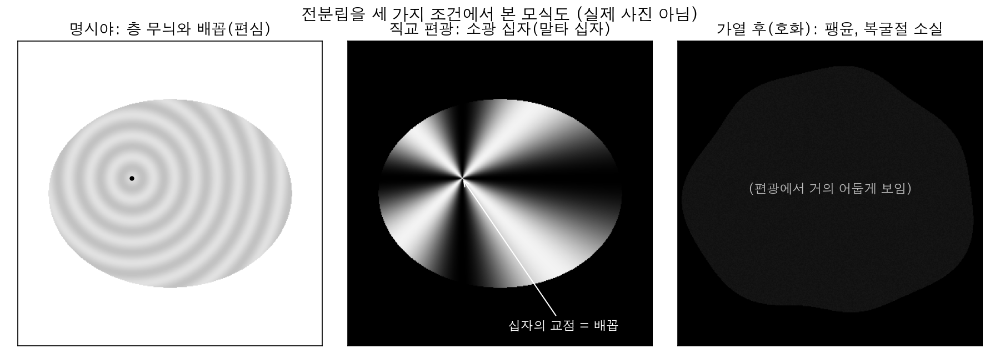
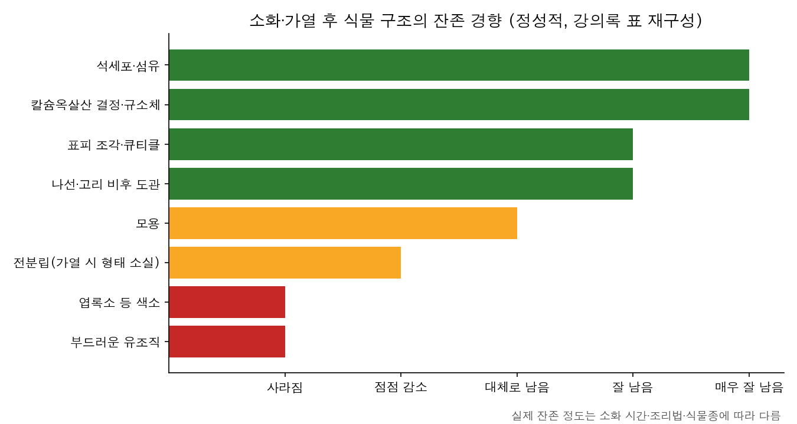

법식물학 시료는 대부분 잎 모양이나 꽃 색을 알아볼 수 없는 상태로 들어옵니다. 부검 때 위에서 걸러낸 갈색 덩어리, 곱게 간 약재 가루, 끓이고 볶은 음식물, 신발 바닥 흙에 섞인 작은 조각 같은 것들입니다. 외부 형태는 사라졌지만 **세포와 조직의 구조는 생각보다 많이 남아 있습니다.** 3주차는 이 "남아 있는 구조"를 현미경으로 찾고, 염색해서 확인하고, 다른 사람이 검증할 수 있게 기록하는 법을 다룹니다.

이 글은 법식물학 강의 3주차 내용을 바탕으로, 관련 문헌과 사례를 추가로 조사해 정리한 스터디 노트입니다.

## 왜 세포벽이 증거가 되는가

동물 세포는 세포막만 있어서 소화액에 금방 무너집니다. 식물 세포는 세포막 바깥에 **세포벽**이 있습니다. 세포벽의 뼈대는 셀룰로스이고, 나무처럼 단단한 부분에는 리그닌이 덧쌓입니다. 사람의 소화효소는 둘 다 거의 분해하지 못합니다. 그래서 씹고 삼킨 채소의 세포벽 윤곽이 위 속에서도 상당 기간 유지됩니다.

여기에 세포 안에 쌓인 **불용성 물질**이 더해집니다. 전분립, 칼슘옥살산 결정, 벼과 식물의 규소체가 대표적입니다. 이 구조들의 모양과 크기는 식물군마다 경향이 있어서, 여러 개를 함께 보면 "어떤 식물의 어느 부위인가"를 좁혀 갈 수 있습니다.

> 해부학적 동정은 특징 하나로 하지 않습니다. 표피, 모용, 결정, 전분, 도관 같은 여러 형질을 조합해 후보를 좁히고, 같은 방법으로 만든 대조 시료와 비교해 확인합니다.
{: .prompt-info }

## 현미경 세 가지와 크기 보정

강의에서는 용도별로 현미경을 나눕니다.

- **실체현미경**(약 7~60배): 입체로 보이므로 시료를 고르고, 위 내용물을 분류하고, 절편을 만들 때 씁니다.
- **명시야 광학현미경**(대물 4~100배): 표피, 단면, 전분립, 결정, 도관을 세포 수준에서 봅니다.
- **편광현미경**: 직교하는 두 편광판 사이에 시료를 두면, 분자가 규칙적으로 배열된 물질만 빛을 돌려 밝게 보입니다(복굴절). 셀룰로스 벽, 칼슘옥살산 결정, 생전분이 여기에 해당합니다.

크기는 감정서에서 중요한 정보입니다. 접안렌즈 안의 눈금(접안마이크로미터)은 배율마다 실제 길이가 다르므로, 슬라이드 위의 표준 눈금(대물마이크로미터)과 맞춰 배율별로 한 칸이 몇 μm인지 구해 둡니다. 예를 들어 접안 40칸이 대물 10칸(100 μm)과 겹치면 접안 한 칸은 2.5 μm입니다. 의료영상에서 픽셀 간격(pixel spacing)을 모르면 병변 크기를 말할 수 없는 것과 같은 이유입니다.

## 염색 반응: 색이 무엇을 말해 주는가

강의록의 염색 시약 가운데 원리를 따로 확인해 본 것은 두 가지입니다.

### 플로로글루시놀-염산 (Wiesner 반응)

목질화된 세포벽을 분홍~적자색으로 물들이는 고전 시약입니다. 흔히 "리그닌 염색"이라고 부르지만, 정확히는 리그닌 전체가 아니라 리그닌 안에 들어 있는 **코니페르알데하이드 같은 알데하이드 잔기**와 반응합니다. Blaschek 등(2020)은 이 반응을 정량화하면서 발색 정도가 코니페르알데하이드 함량과는 비례하지만 **총 리그닌량과는 비례하지 않는다**고 보고했습니다. 같은 연구에서 발색은 불안정해 하루 안에 퇴색하고, 한번 퇴색하면 다시 물들일 수 없다고 했습니다.

실무에서 이 차이가 중요한 이유는 음성 해석 때문입니다. 색이 약하다고 해서 "목질화되지 않은 조직"이라고 단정할 수 없습니다. 염색한 슬라이드는 바로 사진으로 남겨야 한다는 실용적인 교훈도 있습니다. 시약에 진한 염산이 들어 있으므로 보호 장비도 필수입니다.

### 요오드-요오드화칼륨 (루골 용액)

전분을 청자색~흑색으로 물들입니다. 전분의 한 성분인 아밀로스는 나선 모양으로 감겨 있는데, 그 나선 안쪽 통로에 요오드 분자와 요오드화 이온이 줄지어 들어가면서 강한 흡수가 생깁니다. 나선 안에 정확히 어떤 요오드 종이 들어가는지는 아직 논쟁 중입니다. Pesek 등(2022)은 계산화학으로 I₂–I₅⁻–I₂ 단위가 반복되는 구조를 유력 후보로 제시했고, **요오드화 이온(I⁻)이 없으면 청색이 거의 나타나지 않는다**는 실험 결과도 함께 보고했습니다. 루골 용액에 요오드화칼륨을 같이 넣는 이유가 이것입니다.

그 밖에 사프라닌(목질화 벽 적색)과 패스트 그린(셀룰로스 벽 청록색)의 이중 염색, 펙틴을 보는 루테늄 레드, 큐틴과 수베린을 보는 수단 III·IV, 다색성 염료인 톨루이딘 블루가 강의록에 소개됩니다.

## 편광으로 보는 전분립과 결정

_전분립을 세 조건에서 본 모식도입니다(직접 그린 그림, 실제 사진 아님). 직교 편광에서 십자 무늬의 교점이 배꼽입니다._

생전분립은 분자가 배꼽(hilum)을 중심으로 방사상으로 배열된 반결정 구조입니다. 그래서 직교 편광에서 십자 모양의 어두운 띠(소광 십자, 흔히 말타 십자)가 보이고, **그 교점이 배꼽의 위치**입니다. 고고식물학 분야의 전분 동정 가이드도 배꼽의 위치(중심/편심), 층 무늬, 균열 모양, 다면체 면, 단립/복립 여부, 소광 십자의 모양을 함께 기록하라고 권합니다. 같은 가이드는 편광으로 먼저 훑고, 약한 요오드 용액으로 작거나 손상된 입자를 찾는 순서를 제안합니다.

강의록이 정리한 식품별 특징을 보면 감자는 크고 배꼽이 한쪽으로 치우친 난형, 밀은 큰 렌즈형과 작은 구형이 섞인 이중 크기 분포, 옥수수는 다각형에 Y자 또는 별 모양 배꼽, 쌀은 3~8 μm의 아주 작은 다각형이 뭉친 복립, 콩류는 가운데가 길게 갈라진 신장형입니다. 문헌에 나오는 수치도 비슷합니다. 감자 전분은 약 5~100 μm로 범위가 넓고, 밀은 약 10 μm를 기준으로 큰 A형과 작은 B형으로 나누는 경우가 많습니다.

문제는 **가열**입니다. 물과 함께 데우면 전분립이 부풀어 터지는 호화가 일어나고, 방사상 배열이 무너지면서 복굴절이 사라집니다. 호화가 시작되는 온도는 곡물마다 다릅니다. 조리된 음식에서는 전분립 형태 정보가 크게 줄어든다는 뜻입니다.

결정도 편광에서 밝게 빛납니다. 칼슘옥살산 결정은 단일결정, 별처럼 뭉친 사정(druse), 바늘 다발인 침상결정(raphide), 모래결정으로 나뉩니다. Franceschi와 Nakata(2005)의 리뷰는 이 결정이 무작위 침전이 아니라 칼슘 조절과 초식 방어를 위해 식물이 정해진 모양과 크기로 만드는 구조라고 정리합니다. 천남성과 식물을 날로 씹었을 때의 화끈거림은 침상결정과 연관된 것으로 알려져 있지만, 디펜바키아 연구에서는 결정의 기계적 손상과 단백분해효소가 함께 작용한다는 설명이 제시되어 있고 정확한 기전은 아직 논쟁 중입니다.

> 강의록의 결정 표에는 **종유체(cystolith)**도 함께 들어 있는데, 종유체는 칼슘옥살산이 아니라 **탄산칼슘**입니다. 묽은 염산을 떨어뜨리면 탄산칼슘은 기포를 내며 녹고, 칼슘옥살산은 기포 없이 녹습니다. 이 차이가 대마 감정에서 쓰입니다.
{: .prompt-tip }

## 표피, 모용, 도관: 위 속에서 가장 자주 보이는 것

**표피**는 한 겹짜리 얇은 막처럼 벗겨져 나오고 소화와 가열에 강해, 위 내용물과 분말 시료에서 가장 흔히 관찰됩니다. 쌍떡잎식물은 물결형이나 다각형 표피세포가 많고, 벼과는 길쭉한 직사각형 세포가 줄지어 있습니다. **기공**은 공변세포 주변 부세포의 배열로 불규칙형, 부등세포형, 평행세포형, 십자세포형, 벼과형으로 나뉘며 분류군마다 경향이 있습니다. 다만 기공 밀도는 환경에 따라 달라지므로 단독 근거로 쓰지 않습니다.

**모용(털)**은 단순털, 별 모양 털, 비늘털, 갈고리털, 분비 기능이 있는 선모로 나뉩니다. 대마가 대표 사례입니다. 미국 SWGDRUG의 대마 모노그래프는 25~100배 저배율에서 종유체 모, 수지샘, 선모를 관찰하고, 종유체 모 기부의 탄산칼슘 침착에 20% 염산 한 방울을 떨어뜨려 **특징적인 기포**를 확인하는 절차를 적어 두었습니다. 그래도 형태 소견만으로 결론 내리지 않고 화학 검사와 함께 판단합니다(12주차에서 다시 다룹니다). 국내에서는 대마 잎과 분비모의 미세구조를 투과전자현미경으로 관찰한 연구(신민철·김은수, 1994)가 있습니다.

**도관**은 벽이 고리, 나선, 계단, 그물 모양으로 두꺼워진 물관 세포입니다. 얇은 벽은 분해되어도 나선형으로 두꺼워진 벽은 용수철처럼 남아 위 내용물에서 눈에 잘 띕니다. **석세포**(배·모과 과육의 까끌한 알갱이, 호두·복숭아 씨 껍질)와 섬유도 소화되지 않는 단서입니다.

강의에서는 이 밖에 목재의 세 단면(횡단·방사·접선)과 침엽수재/활엽수재의 차이(IAWA 특징 목록), 잎·줄기·뿌리 횡단면에서 외떡잎식물과 쌍떡잎식물을 구분하는 법(책상조직과 해면조직, 관다발 배열, 뿌리의 물관부 모양)도 다룹니다.

_강의록의 표를 정성적으로 재구성한 그림입니다. 실제 잔존 정도는 소화 시간, 조리법, 식물종에 따라 다릅니다._

## 실제 사례: 위 내용물 속 채소 세포

이 분야를 개척한 사람은 콜로라도 대학교 볼더 캠퍼스의 식물학자 Jane Bock과 생리학자 David Norris입니다. 대학 소식지에 따르면 출발점은 **1982년**, 덴버 지역 부검의였던 Ben Galloway 박사가 동부 콜로라도에서 발견된 젊은 여성 피해자의 위 내용물을 식별해 줄 수 있는지 물어 온 일이었습니다. Bock은 흔한 샐러드 채소를 사서 직접 씹고 슬라이드로 만들어 대조 세트를 꾸렸습니다. 위 내용물은 샐러드 채소와 일치했고 햄버거는 없었습니다. 피해자가 남자친구와 함께 먹은 점심이 마지막 식사가 아니라는 뜻이었고, 이는 남자친구의 알리바이를 뒷받침했습니다.

이 경험은 미국 국립사법연구소(NIJ)가 지원한 실험 매뉴얼로 이어졌습니다. Bock, Lane, Norris가 **1988년**에 낸 *Identifying Plant Food Cells in Gastric Contents for Use in Forensic Investigations*(130쪽)입니다. 초록은 식물 세포벽이 소화되지 않아 현미경으로 유래 식물을 동정할 수 있는 경우가 많다고 설명합니다. 동시에 **씹고 삼킨 세포는 교과서 사진과 같지 않다**는 점, 감자·밀·쌀 같은 전분 식품은 이 매뉴얼의 대상이 아니라는 점을 분명히 적어 둡니다. 슬라이드 제작법, 이분 검색표, 주사전자현미경 사진이 들어 있습니다.

가장 유명한 사건은 **1993년 10월** 콜로라도주 스팀보트스프링스에서 Gerald Boggs가 살해된 사건입니다. Boggs는 매일 같은 식당에서 계란, 해시브라운, 토스트, 커피로 똑같은 아침을 먹었습니다. Bock과 Norris는 위에서 해시브라운 흔적을 찾았고, 아침 식사 몇 시간 뒤에 사망했다고 판단했습니다. 용의자 Jill Coit와 남자친구 Michael Backus는 저녁 시간대 알리바이는 있었지만 아침 이후 시간대 알리바이는 없었습니다. Norris는 이 소견이 수색영장을 받기에 충분했다고 회고했고, 두 사람은 **1995년** 1급 살인으로 유죄 판결을 받았습니다. 위 내용물이 유일한 증거는 아니었습니다. 차에서 나온 전기충격기 같은 다른 물증이 함께 있었습니다.

두 연구자는 약 50건의 사건에 참여했고, 2016년에는 교과서 *Forensic Plant Science*를 냈습니다. 이 책은 디지털 식물 세포 아틀라스를 동반 웹사이트로 제공합니다.

> 사망 시각 추정에서 위 내용물은 "마지막 식사가 무엇이었는가"를 알려 줄 뿐, 그 식사가 언제였는지는 목격자·영수증 같은 외부 정보와 결합해야 의미가 생깁니다. Boggs 사건도 "매일 같은 아침을 먹었다"는 생활 패턴이 있었기에 해시브라운 소견이 시간 정보로 바뀌었습니다.
{: .prompt-info }

## 한계와 과대 해석 주의

> **보이지 않는다는 것은 없었다는 증거가 아닙니다.** 가열로 전분립이 호화되면 형태와 복굴절이 사라지고, 부드러운 유조직은 소화로 쉽게 분해됩니다. 전분립이 안 보인다고 감자나 곡물을 먹지 않았다고 결론 내리면 안 됩니다.
{: .prompt-warning }

- **대조 시료 없이 동정하지 않습니다.** 씹고 소화된 세포는 교과서 사진과 다릅니다. 출처가 확실한 표본(학명, 채취지, 일자)으로 같은 방법의 슬라이드를 만들어 비교해야 합니다.
- **한 형질에 기대지 않습니다.** 침상결정은 독성 천남성과의 단서지만 식품 식물에도 있습니다. 기공 밀도는 같은 식물에서도 환경에 따라 달라집니다.
- **염색 결과도 해석 범위가 있습니다.** 플로로글루시놀 반응은 리그닌의 특정 잔기를 보며, 발색이 약하다고 목질화가 없다는 뜻은 아닙니다.
- **수치는 경향입니다.** 전분립 크기 범위는 품종과 조건에 따라 달라집니다. 감정에서는 "범위와 측정 개수"를 함께 적습니다.
- 참고로 형태로 좁히기 어려운 경우 DNA 분석을 병행하는 방법도 있지만, 이 강의는 형태·해부학적 동정에 집중합니다.

## 정리: 좋은 현미경 기록의 조건

강의록은 관찰 기록을 "다른 전문가가 같은 슬라이드를 보고 확인할 수 있게" 쓰라고 강조합니다. 시료 번호와 제작법(습식, 표피 복제, 염색 여부), 현미경 종류와 배율과 보정값, 구조의 이름과 형태, 크기(범위와 측정 개수), 축척 막대가 있는 사진, 그리고 소화·가열·오염 같은 관찰의 한계를 남깁니다.

의료영상 쪽 사람 입장에서 보면 이 과정은 판독 보고서와 많이 닮았습니다. 보정된 단위로 측정하고, 소견과 해석을 분리하고, 음성 소견을 조심스럽게 다루고, 비교 대상(대조 시료)을 명시합니다. 3주차에서 익힌 "조직 수준의 언어"는 4주차의 검색표 동정, 9~10주차의 위 내용물 감정, 11~12주차의 독성 식물 감정으로 그대로 이어집니다.

## 참고문헌

- 법식물학 3주차 강의록, 「식물 해부학과 조직학」.
- Bock, J. H., Lane, M. A., & Norris, D. O. (1988). *Identifying Plant Food Cells in Gastric Contents for Use in Forensic Investigations: A Laboratory Manual*. National Institute of Justice Research Report (NCJ 110008). <https://www.ojp.gov/ncjrs/virtual-library/abstracts/identifying-plant-food-cells-gastric-contents-use-forensic>
- Bock, J. H., & Norris, D. O. (2016). *Forensic Plant Science*. Academic Press.
- University of Colorado Boulder. (2016). Murder, they wrote: Plant forensic scientists help solve crimes. *CU Boulder Today*. <https://www.colorado.edu/today/2016/01/28/murder-they-wrote-plant-forensic-scientists-help-solve-crimes>
- University of Colorado Boulder. (2016). Planted evidence. *Coloradan*. <https://www.colorado.edu/coloradan/2016/03/01/planted-evidence>
- Blaschek, L., et al. (2020). Cellular and genetic regulation of coniferaldehyde incorporation in lignin of herbaceous and woody plants by quantitative Wiesner staining. *Frontiers in Plant Science*, 11, 109. <https://pmc.ncbi.nlm.nih.gov/articles/PMC7061857/>
- Pesek, S., Lehene, M., Brânzanic, A. M. V., & Silaghi-Dumitrescu, R. (2022). On the origin of the blue color in the iodine/iodide/starch supramolecular complex. *Molecules*, 27(24), 8974. <https://pmc.ncbi.nlm.nih.gov/articles/PMC9784209/>
- Franceschi, V. R., & Nakata, P. A. (2005). Calcium oxalate in plants: formation and function. *Annual Review of Plant Biology*, 56, 41–71.
- Gardner, D. G. (1994). 디펜바키아에 의한 구강 점막 손상 리뷰. *Oral Surgery, Oral Medicine, Oral Pathology* (PMID 7838472, 초록 기준). <https://www.qxmd.com/r/7838472>
- SWGDRUG. Marijuana monograph. <https://www.swgdrug.org/Monographs/MARIJUANA.pdf>
- University of Sheffield Archaeobotany. Starch: Identification. <https://sites.google.com/sheffield.ac.uk/archaeobotany/starch/identification>
- 신민철, 김은수 (1994). 대마(Cannabis sativa L.) 영양조직의 색소체 비교. *Applied Microscopy*, 24(4), 1–12. <https://koreascience.kr/article/JAKO199418841121517.page>

[발표자료 (PPTX) 내려받기](/assets/files/forensic-botany/forensic-botany-week03.pptx)

---

**법식물학 스터디** · ← [2주차 식물 형태학 기초](/posts/forensic-botany-02-plant-morphology/) | [4주차 식물 분류학과 동정](/posts/forensic-botany-04-taxonomy-and-identification/) →
