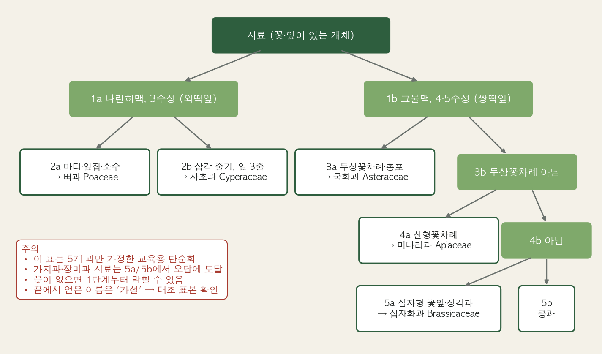
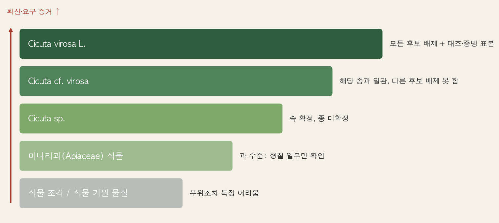

현장에서 수거한 초록색 조각이 "식물 조각"으로만 보고되면 수사에는 거의 도움이 되지 않습니다. 그런데 "미나리과 식물의 잎"이나 "투구꽃속(*Aconitum*)"으로 보고되면 이야기가 달라집니다. 독성 식물인지, 어떤 환경에서 자라는지, 어느 계절에 나오는지까지 따라옵니다. 반대로 확신하지 못하는 시료를 종 이름으로 단정하면, 그 이름 하나가 수사와 재판을 엉뚱한 쪽으로 끌고 갈 수 있습니다.

이 글은 법식물학 강의 4주차 내용을 바탕으로, 관련 문헌과 사례를 추가로 조사해 정리한 스터디 노트입니다. 2주차(외부 형태)와 3주차(내부 조직)에서 본 관찰 결과를 **이름**으로 묶는 단계, 곧 동정(同定, identification)을 다룹니다.

> 동정은 정답을 맞히는 일이 아닙니다. 증거가 지지하는 범위 안에서 후보를 좁히고, 더 좁힐 수 없으면 그 사실을 기록하는 일입니다.
{: .prompt-info }

## 분류 계급: 어디까지 내려갈 것인가

식물은 계–문–강–목–과–속–종의 계급으로 나눕니다. 필요하면 종 아래에 아종(subsp.), 변종(var.), 품종(f., forma)을 둡니다. 여기서 분류 계급인 **품종(forma)** 은 사람이 선발해 기른 **재배품종(cultivar)** 과 다릅니다. 재배품종 이름은 국제식물명명규약(ICN)이 아니라 별도의 국제재배식물명명규약(ICNCP)이 다룹니다.

법식물학 실무에서 실제로 쓰이는 계급은 대부분 **과·속·종** 세 단계입니다. 감정의 질은 "몇 단계까지 내려갔는가"보다 "왜 그 단계에서 멈췄는가"를 설명할 수 있느냐에 달려 있습니다.

## 학명 읽고 쓰기

### 이명법과 명명자

학명은 린네가 1753년 『Species Plantarum』에서 체계화한 **이명법**을 따릅니다. 속명과 종소명 두 단어로 쓰고, 속명은 대문자로 시작하며 둘 다 이탤릭으로 씁니다. 그 뒤에 명명자를 붙입니다. *Ricinus communis* L.(피마자)의 L.은 Linnaeus입니다.

명명자에 대해 조금 더 정확히 짚어 두겠습니다. 강의록은 명명자를 "처음 이름을 붙인 사람"으로 설명하지만, ICN에서 명명자는 그 이름을 **적법하게 발표한** 사람입니다(제46조). 종이 다른 속으로 옮겨지면 원래 명명자를 괄호에 넣고, 새 조합을 발표한 사람을 뒤에 씁니다. *Helianthemum coridifolium* (Vill.) Cout.은 Villars가 처음 다른 속으로 발표했고 Coutinho가 지금의 속으로 옮겼다는 뜻입니다. 명명자 약어는 표준 약어(Brummitt & Powell, 1992)를 따르고, IPNI에서 찾을 수 있습니다.

### 규약은 계속 바뀐다

학명 규칙을 정하는 문서가 **국제조류·균류·식물명명규약(ICN)** 입니다. 2011년 멜버른 국제식물학회의(IBC)에서 이전 이름(ICBN)에서 지금 이름으로 바뀌었습니다. 6년마다 열리는 IBC에서 개정되며, 2017년 선전 회의 결정을 담은 **선전 규약**(2018년 발간)에 이어, 2024년 7월 마드리드 제20차 IBC 결정을 반영한 **마드리드 규약**이 2025년 7월 나왔습니다. 마드리드 회의에서는 400건이 넘는 개정안이 논의되었고, 식물·조류 이름의 자발적 등록 제도 같은 변화가 채택되었습니다.

ICN의 기본 원칙 중 법식물학에 직접 닿는 것은 두 가지입니다.

- **기준표본(type)**: 이름은 표본관에 보관된 특정 표본에 묶여 있습니다. 이름의 최종 근거가 말로 된 정의가 아니라 실물이라는 뜻입니다.
- **선취권(priority)**: 적법하게 먼저 발표된 이름이 우선합니다. 1753년 5월 1일이 출발점입니다. 연구가 진척되면 이름이 바뀌고, 이전 이름은 이명(synonym)이 됩니다.

그래서 감정서에는 **어떤 목록과 어떤 분류 체계를, 언제 기준으로 따랐는지** 적어 두어야 합니다. 몇 년 뒤 학명이 바뀌어도 감정 내용이 무엇을 가리켰는지 추적할 수 있게 하기 위해서입니다.

### 확신의 정도를 표기하는 약어

| 표기 | 의미 |
|---|---|
| *Aconitum* sp. | 속은 확인, 종은 미확정 (단수) |
| *Aconitum* spp. | 그 속의 여러 종을 통틀어 |
| *Aconitum* cf. *jaluense* | jaluense와 비교되나 확정 불가 (confer) |
| *Aconitum* aff. *jaluense* | 가깝지만 별개의 종일 가능성 (affinis) |

이렇게 확정하지 못한 수준을 이름에 드러내는 방식을 **열린 명명법(open nomenclature)** 이라고 합니다. 고생물학자 Bengtson(1988)은 aff.는 아직 기재되지 않은 새 종일 가능성을, cf.와 ?는 동정의 불확실성을 나타낸다고 정리했습니다. 동시에 aff., cf., ?를 "불확실성의 정도"로 단계화해 쓰자는 제안이 오히려 해석을 불안정하게 만든다고 지적했습니다. Sigovini 등(2016)은 이 한정어들이 실제로 제각각 쓰이고 있음을 정리하고, 불확실성이 어디서 왔는지를 구분하는 흐름도를 제안했습니다.

> ICN은 cf.나 aff.의 사용법을 규정하지 않습니다. 열린 명명법은 주로 동물학·고생물학에서 다듬어진 관행입니다. 감정서에 cf.를 쓸 때는 약어만 남기지 말고 "무엇 때문에 확정하지 못했는지"를 문장으로 함께 적는 것이 안전합니다.
{: .prompt-warning }

## APG IV: 과의 경계가 움직였다

과거에는 꽃과 열매의 형태가 분류의 중심이었지만, 지금은 DNA를 포함한 계통 연구로 진화적 유연관계를 반영하는 분류가 주류입니다. 속씨식물에서는 **APG IV**(Angiosperm Phylogeny Group, 2016)가 대표적이며, 64목 416과를 인정합니다.

이 변화의 대표 피해자가 옛 백합과입니다. 예전 도감에서 백합과로 묶였던 식물이 여러 과로 나뉘었습니다.

- 박새(*Veratrum*) → 멜란티움과(Melanthiaceae, 백합목)
- 은방울꽃(*Convallaria*) → 비짜루과(Asparagaceae, 비짜루목)

국내 자료에도 APG 체계를 반영한 목록과 이전 체계를 쓴 도감이 섞여 있습니다. 게다가 과의 한글 이름도 자료마다 다릅니다. Lee, Jung & Kim(2015)은 APG III의 목·과 국문명이 사례별로 제각각 붙어 표준이 없다는 문제를 지적하고 표준안을 제안했습니다. 실무 결론은 간단합니다. **감정서에는 라틴어 과명을 반드시 함께 적습니다.**

## 국내 표준 자료와 국제 데이터베이스

| 자료 | 운영 | 용도 |
|---|---|---|
| 국가표준식물목록(KPNI) | 국립수목원·한국식물분류학회 | 국내 식물의 표준 학명·국명·이명 |
| 국가생물종목록 | 국립생물자원관 | 국내 생물종 목록(2023년 말 6만여 종) |
| 국가생물종지식정보시스템 | 국립수목원 구축으로 알려짐 | 종별 정보와 사진 |
| POWO, WFO, IPNI | Kew 등 국제 기관 | 학명·이명·명명자 확인 |

국가표준식물목록은 국립수목원과 한국식물분류학회가 공동으로 검토해 정명과 이명의 관계를 제공하는 목록이고, 국내 식물상 논문 대부분이 이 목록을 따라 학명과 국명을 씁니다. 실습에서도 동정한 식물의 학명을 이 목록과 POWO에서 각각 찾아 비교해 보게 되는데, 두 자료가 다른 이름을 정명으로 채택하는 경우가 실제로 있습니다. 그 차이를 감정서에 남기는 것이 바로 앞에서 말한 "어떤 목록을 따랐는지"의 실천입니다.

## 이분 검색표: 두 갈래 길을 끝까지

이분 검색표(dichotomous key)는 서로 배타적인 두 진술 중 시료에 맞는 쪽을 고르며 이름에 도달하는 도구입니다. 강의에서 연습용으로 쓴 간이 검색표를 그림으로 옮기면 다음과 같습니다.

_강의록 4.2의 과 수준 간이 검색표를 도식화한 것입니다. 5개 과만 가정한 교육용 단순화입니다._

검색표 사용 원칙은 다섯 가지로 정리됩니다.

1. 첫 진술이 맞아 보여도 **두 번째 진술까지 읽고** 고릅니다.
2. 판단이 애매한 형질은 다른 형질이나 여러 개체로 확인합니다.
3. 모르는 용어는 추측하지 말고 용어집에서 찾습니다.
4. 검색표 끝에서 얻은 이름은 **가설**입니다. 도감 기재와 대조 표본으로 확인합니다.
5. 어느 단계에서 어느 쪽을 골랐는지 **경로를 기록**합니다. 재현과 검토에 필요합니다.

위 간이 검색표는 일부러 허점이 있습니다. 가지과나 장미과 시료를 넣으면 5a/5b 중 하나로 억지로 떨어집니다. 검색표는 **자신이 포함하지 않은 분류군을 "모른다"고 말하지 못합니다.** 의료영상 AI를 하는 입장에서 보면, 학습하지 않은 클래스를 넣어도 기존 클래스 중 하나를 높은 확률로 내놓는 분류기와 똑같은 문제입니다(open-set 문제). 실제 감정에서는 지역 식물지의 전체 검색표를 써야 하는 이유입니다.

법식물 시료에는 꽃과 열매가 없는 경우가 많습니다. 그러면 1단계부터 막힙니다. 이때는 잎의 배열, 털, 잎맥, 선점, 눈과 수피, 그리고 3주차에서 본 해부학적 형질을 조합하고, 과 수준에서 멈추되 "후보 과"를 병기합니다. 증거 시료가 나온 현장에서 같은 식물이 자라는지 확인해 꽃과 열매가 달린 대조 표본을 채집하는 것도 중요한 방법입니다.

## 한국의 주요 과와 독성 식물 후보

강의에서는 국내에서 자주 만나는 13개 과(벼과, 국화과, 콩과, 장미과, 십자화과, 미나리과, 가지과, 미나리아재비과, 천남성과, 멜란티움과, 비짜루과, 대극과, 협죽도과)의 대표 형질과 독성 후보를 정리했습니다. 몇 가지만 추리면 다음과 같습니다.

| 과 | 알아보는 형질 | 독성 후보 예 |
|---|---|---|
| 미나리과 Apiaceae | 산형꽃차례, 속 빈 줄기, 잎자루가 줄기를 감쌈 | 독미나리 |
| 미나리아재비과 Ranunculaceae | 수술·암술 다수 나선 배열, 골돌과 | 투구꽃, 동의나물 |
| 멜란티움과 Melanthiaceae | 백합형 외떡잎, 뿌리줄기 | 박새 |
| 비짜루과 Asparagaceae | 백합형 외떡잎, 비늘줄기·뿌리줄기 | 은방울꽃 |
| 대극과 Euphorbiaceae | 흰 유액, 단성화, 삭과 | 피마자(씨) |

과 이름만으로 독성을 판단할 수는 없습니다. 국화과처럼 대부분 식용·약용인 과도 있고, 독미나리와 미나리처럼 **같은 과 안에서** 닮은 경우도, 박새와 산마늘처럼 **다른 과인데** 겉모습이 닮은 경우도 있습니다. 독성 판단은 종 수준의 동정과 성분 분석이 함께 있어야 합니다(11~12주차 주제).

## 동정 절차와 오류의 원인

강의에서 제시한 절차는 7단계입니다. 시료 접수와 기록(증거보관연속성 확인) → 부위 판별 → 형질 관찰 → 검색표·도감으로 후보 선정 → 후보 표본과 같은 방법으로 대조 → 동료의 독립적·맹검 검토 → 동정 수준과 확신 결정.

동정이 틀리는 이유는 형태 변이, 수렴(관계없는 식물이 닮음), 재배종, 잡종, 미성숙·손상 시료, 오래된 자료, 그리고 **확증편향**입니다. 마지막 항목은 식물학 바깥의 연구가 잘 보여줍니다. Dror, Charlton & Péron(2006)은 지문 감정관 5명에게 그들이 과거 실제 사건에서 '일치'로 판정했던 지문 쌍을, "마드리드 테러 오인 체포 사건의 지문"이라는 맥락과 함께 다시 보여주었습니다. 그러자 다수가 자신의 이전 판정과 다른 결론을 냈습니다. 표본은 작지만, 숙련된 전문가도 맥락 정보에 흔들린다는 점을 실제 업무 환경에서 보여준 연구입니다. 식물 동정에서도 "용의자 집 마당에 독미나리가 있다"는 정보를 먼저 들으면 애매한 형질을 그쪽으로 읽기 쉽습니다.

## 표본: 감정을 재현 가능하게 만드는 실물

압착 표본은 채집(가능하면 꽃·열매·땅속 부분 포함, 즉시 사진과 번호) → 신문지 사이에서 압착 → 초기 며칠은 신문지를 자주 교체하며 건조 → 표본지에 마운트하고 라벨 부착 → 냉동 처리로 해충 방제 후 표본관 보관 순서로 만듭니다. 라벨에는 학명(감정자·감정일·분류 체계), 국명·과명, 채집지 좌표와 고도, 서식 환경, 채집일·채집자·채집 번호, 그리고 꽃 색·냄새·수액 색처럼 **건조하면 사라지는 형질**을 적습니다.

법식물학에서는 표본을 세 종류로 구분합니다.

- **증거 시료(questioned sample)**: 사건에서 압수된 시료. 증거보관연속성을 유지하고 훼손을 최소화합니다.
- **대조 표본(reference specimen)**: 비교를 위해 현장이나 그 부근에서 채집한 알려진 식물.
- **증빙 표본(voucher specimen)**: 감정 근거를 나중에 다시 확인할 수 있도록 표본관에 영구 보관하는 표본.

Culley(2013)는 바우처를 연구 대상 분류군에 대한 "구체적이고 검증 가능한 유일한 증거"로 보았고, 검색표로 좁힌 후보를 확정할 때 쓰이며, 개인 소장 표본은 다른 연구자가 접근하기 어려워 바우처로 부적합하다고 정리했습니다. 감정에 그대로 옮기면, **증빙 표본이 없는 동정은 다른 전문가가 재검토할 방법이 없습니다.** 표본관은 Index Herbariorum에 등록된 약어로 구별되므로, 감정서에 "어느 표본관, 몇 번 표본"을 적을 수 있습니다.

## 실제 사례

### 박새를 산마늘로: 23명 집단 중독

이세형 등(2010)은 강릉 지역에서 성인 23명이 산에서 뜯은 잎을 쌈으로 먹고 집단 중독된 사례를 보고했습니다. 원인은 박새(*Veratrum patulum*)였고, 논문은 박새가 5월 무렵 산마늘(*Allium victorialis* var. *platyphyllum*)로 자주 오인된다고 적고 있습니다. 섭취 30분~2시간 뒤 전원이 오심·구토를 보였고, 18명에서 동서맥, 다수에서 저혈압이 나타났습니다. 10명이 아트로핀 치료를 받았고 전원 회복했습니다. 국내에서는 2005년, 2006년, 2015년에도 박새 중독 보고가 이어졌습니다.

식약처 웹진(2025년 4월)은 산마늘을 은방울꽃과 짝지어 구별 형질을 제시합니다. 산마늘은 마늘 향이 짙고 잎 끝이 뭉툭하며 갈색 그물 섬유에 싸인 비늘줄기가 있고, 은방울꽃은 잎 끝이 뾰족하고 비늘줄기 없이 땅속줄기가 뻗습니다. 결론은 "구분이 쉽지 않으니 채취하지 않는 것이 가장 좋은 예방"이었습니다. 감정인 입장에서는 **냄새와 땅속 기관**처럼 시료에서 사라지기 쉬운 형질이 결정적이라는 점이 핵심입니다. 라벨에 "건조 후 사라지는 형질"을 적으라는 이유와 정확히 겹칩니다.

### 이름이 비슷해서: 벨기에의 '한약 신병증'

1990년대 초 벨기에의 한 체중감량 처방에서 젊은 여성들에게 급속 진행성 신섬유화가 잇따랐습니다(Vanherweghem 등, 1993). 처방에 들어 있어야 할 방기(*Stephania tetrandra*) 자리에 신독성 성분인 아리스톨로크산을 가진 *Aristolochia* 속 식물이 들어간 것으로 밝혀졌습니다. Meyer 등(2000)의 정리에 따르면 처방 복용자 1,741명 가운데 약 100명이 발병했고, 혼동의 큰 원인은 "Fangji"와 "Fangchi"라는 **비슷한 생약명**이었습니다. 대체된 식물을 문헌에 따라 *A. fangchi* 또는 *A. manshuriensis*로 다르게 기술하는 것도 눈여겨볼 점입니다. 관용명이 아닌 학명, 그리고 학명을 뒷받침하는 실물 표본이 왜 필요한지 보여주는 사례입니다.

### 탄화목의 수종 비교

이준배 등(2024)은 차량 화재 현장과 인근 화재 현장에서 나온 탄화목을 세척·건조한 뒤 전자현미경으로 관찰해, 벽공(pit) 구조가 뚜렷하게 비슷하다는 점에서 두 시료가 같은 수종일 가능성을 제시했습니다. 꽃도 잎도 없는 시료에서 해부학적 형질만으로 "같은 수종일 가능성"까지 말한 사례로, 동정 수준과 표현이 증거에 맞춰 조절된 좋은 예입니다.

참고로 형태로 해결되지 않을 때는 DNA 바코드(엽록체 psbA-trnH 영역 등)를 쓰는 방법도 있으며, 국내에서도 법과학적 식물 유전자검사 시험법 연구(한시내 외, 2016)가 있습니다. 이 강의의 범위는 아니어서 여기서는 존재만 언급합니다.

## 한계와 과대 해석 주의

동정 결과를 보고하는 문장은 다음처럼 수준·근거·한계를 함께 담아야 합니다.

> 시료 A: 미나리과(Apiaceae) 식물의 잎 조각. 근거: 표피 형태, 도관, 털의 구조. 속 이하는 확정할 수 없음. 이유: 꽃과 열매가 없고 잎이 부서져 있음.
{: .prompt-tip }

확신의 단계를 그림으로 정리하면 이렇습니다.

_위로 갈수록 더 많은 증거가 필요합니다. 종 이름 단정은 다른 모든 후보를 배제했을 때만 씁니다._

"독미나리와 일치한다" 같은 단정은 해당 종의 다른 후보를 모두 배제했을 때만 씁니다. 그렇지 않으면 cf.나 "~와 일관된다(consistent with)"를 쓰고, 배제하지 못한 후보를 함께 적습니다.

과대 해석을 막기 위한 점검 항목을 정리합니다.

- **증거 가치는 희귀성에 달려 있습니다.** 현장과 용의자 신발에서 같은 흔한 잡초가 나왔다면 의미는 작습니다. 분포가 좁거나 개화기가 짧은 식물이라야 무게가 실립니다. 그런데 "흔하다/드물다"는 대개 통계가 아니라 전문가 판단이므로, 그 근거(문헌, 표본관 자료, 현장 조사)를 감정서에 밝혀야 합니다.
- **검색표 결과는 가설입니다.** 검색표에 없는 분류군은 엉뚱한 이름으로 떨어집니다.
- **맥락 정보는 판단을 흔듭니다.** 가능하면 사건 정보 없이 독립 검토를 받습니다.
- **학명은 바뀝니다.** 사용한 목록·체계·조회 날짜를 기록합니다.
- **약어만으로는 부족합니다.** cf.와 aff.는 사람마다 다르게 쓰므로 이유를 문장으로 덧붙입니다.

> 종까지 동정할 수 있어도 속 수준으로 보고하는 편이 나은 경우가 있을까요? 예를 들어 그 속의 모든 종이 같은 독성 성분을 갖고 있어 수사상 결론이 달라지지 않는데, 종 수준 판단에 쓰인 형질이 손상 시료에서 애매했다면, 속 수준 보고가 더 정직하고 반박에도 강합니다.
{: .prompt-info }

## 정리

- 동정은 후보를 좁히는 일이며, **어디서 멈췄는지와 그 이유**가 감정의 품질입니다.
- 학명은 ICN(최신 마드리드 규약, 2025)을 따르고, 명명자는 적법 발표자입니다. 감정서에는 사용한 목록·체계·시점을 적습니다.
- APG IV로 과의 경계가 바뀌었고 국문 과명도 자료마다 다르므로 **라틴어 과명을 병기**합니다.
- 이분 검색표는 두 진술을 모두 읽고 경로를 기록하며, 결과는 가설로 다룹니다.
- 증거 시료·대조 표본·증빙 표본을 구분하고, 증빙 표본으로 동정을 재현 가능하게 만듭니다.
- 보고는 수준·근거·한계를 함께 쓰고, 단정은 모든 후보를 배제했을 때만 합니다.

## 참고문헌

- 법식물학 4주차 강의록, 「식물 분류학과 동정」.
- Angiosperm Phylogeny Group (2016). An update of the Angiosperm Phylogeny Group classification for the orders and families of flowering plants: APG IV. *Botanical Journal of the Linnean Society*, 181(1), 1–20. <https://doi.org/10.1111/boj.12385>
- Turland, N. J. et al. (Eds.) (2018). *International Code of Nomenclature for algae, fungi, and plants (Shenzhen Code)*. Regnum Vegetabile 159. <https://doi.org/10.12705/Code.2018>
- Turland, N. J. et al. (Eds.) (2025). *International Code of Nomenclature for algae, fungi, and plants (Madrid Code)*. Regnum Vegetabile 162. University of Chicago Press. <https://press.uchicago.edu/ucp/books/book/chicago/I/bo251991590.html>
- Wikipedia. Author citation (botany). <https://en.wikipedia.org/wiki/Author_citation_(botany)>
- Lee, Y., Jung, J. & Kim, S. (2015). APG III 분류체계의 목명 및 과명 국문화에 대한 제안. 식물분류학회지, 45(3), 278–297. <https://koreascience.kr/article/JAKO201530261998353.page>
- Bengtson, P. (1988). Open nomenclature. *Palaeontology*, 31(1), 223–227. <https://www.palass.org/publications/palaeontology-journal/archive/31/1/article_pp223-227>
- Sigovini, M., Keppel, E. & Tagliapietra, D. (2016). Open nomenclature in the biodiversity era. *Methods in Ecology and Evolution*, 7(10), 1217–1225. <https://doi.org/10.1111/2041-210X.12594>
- Dror, I. E., Charlton, D. & Péron, A. E. (2006). Contextual information renders experts vulnerable to making erroneous identifications. *Forensic Science International*, 156(1), 74–78. <https://eprints.soton.ac.uk/27807>
- Culley, T. M. (2013). Why vouchers matter in botanical research. *Applications in Plant Sciences*, 1(11), 1300076. <https://pmc.ncbi.nlm.nih.gov/articles/PMC4103463>
- 이세형 외 (2010). 집단으로 발생한 박새 중독 23예. 대한내과학회지, 79(4), 417–421. <https://www.ekjm.org/journal/view.php?number=21117>
- 식품의약품안전처 (2025.4.15). 독초 vs 산나물, 올바른 구분법. 열린마루 2025년 4월호. <https://mfds.go.kr/webzine/202504/sub02.html>
- Meyer, M. M., Chen, T. P. & Bennett, W. M. (2000). Chinese herb nephropathy. *Proceedings (Baylor University Medical Center)*, 13(4), 334–337. <https://pmc.ncbi.nlm.nih.gov/articles/PMC1312226>
- 이준배 외 (2024). 목재해부학에 의한 목재 수종 비교. 한국법과학회지, 25(1), 8–15. <https://www.earticle.net/Article/A451210>
- 한시내, 박은영, 이혜진, 안희중 (2016). 법과학적 활용을 위한 식물 유전자검사 시험법 연구. 한국법과학회지, 17(1), 32–36. <https://www.earticle.net/Article/A270719>
- 국립수목원·한국식물분류학회. 국가표준식물목록(KPNI). 소개: <https://bartoc.org/en/node/20561>
- 국립생물자원관. 국가생물종목록. 소개: <https://en.wikipedia.org/wiki/Korean_National_Species_List>

[발표자료 (PPTX) 내려받기](/assets/files/forensic-botany/forensic-botany-week04.pptx)

---

**법식물학 스터디** · ← [3주차 식물 해부학과 조직학](/posts/forensic-botany-03-plant-anatomy-histology/) | [5주차 현장 식물 증거의 채취와 보존](/posts/forensic-botany-05-field-collection-and-preservation/) →
