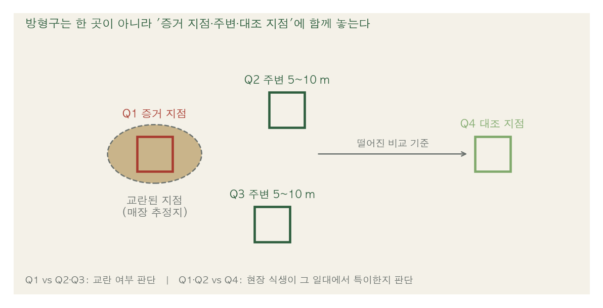
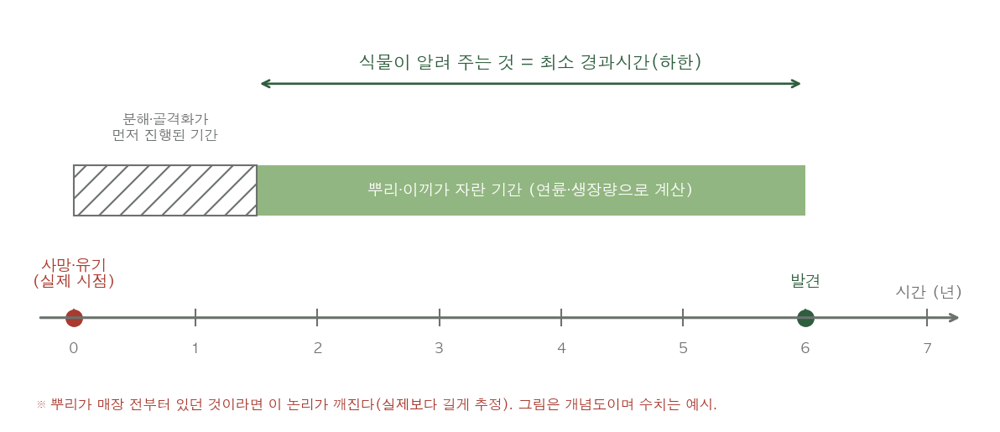

4주차까지는 이미 손에 들어온 시료를 어떻게 동정하느냐를 다뤘습니다. 그런데 실험실에 도착한 잎 조각이 비닐 봉투 안에서 곰팡이투성이가 되어 있거나, 용의자의 신발과 현장 풀이 같은 상자에 담겨 왔다면 어떨까요. 아무리 정교하게 동정해도 법정에서는 "그 조각이 정말 현장에서 왔는가, 오는 길에 섞인 것은 아닌가"라는 질문에 답할 수 없습니다. **식물 증거의 가치는 실험실이 아니라 현장에서 먼저 결정됩니다.** 5주차는 그 현장 단계, 곧 기록하고 채취하고 포장하고 넘겨주는 절차를 다룹니다.

이 글은 법식물학 강의 5주차 내용을 바탕으로, 관련 문헌과 사례를 추가로 조사해 정리한 스터디 노트입니다.

## 현장에서 식물은 어떤 질문에 답하는가

강의록은 현장 식물 증거가 답할 수 있는 질문을 네 가지로 나눕니다.

| 질문 | 식물 증거의 예 | 주의할 점 |
|---|---|---|
| 어디서 (장소) | 용의자 물건의 식물 조각과 현장 식생의 일치 | 흔한 종일수록 증거 가치가 낮음 |
| 무엇이 (교란) | 눌리거나 꺾인 식물, 파헤친 흙 위의 식생 변화 | 동물·폭우·벌목도 같은 흔적을 남김 |
| 언제 (시간) | 변색, 재생장, 개화·결실 시기, 뿌리 연륜 | 대부분 범위로만 말할 수 있음 |
| 누구·무엇과 (연계) | 의류·신발·차량에 붙은 잎, 씨앗, 가시 | 오염·이차 전이 가능성 배제 필요 |

이 네 질문 중 어느 것도 "현장의 원래 상태가 어땠는가"를 모르면 답할 수 없습니다. 그래서 강의록의 핵심 원칙은 한 문장으로 정리됩니다. **많이 채취하는 것보다, 채취하기 전에 기록하고 채취하는 동안 오염과 손상을 막는 것이 중요하다**는 것입니다.

## 1. 현장에 들어가기 전: 동선과 오염

식물 증거는 시신, 발자국, 타이어 자국, 혈흔과 같은 공간에 있습니다. 식물 담당자는 현장 책임자의 통제 아래에서 움직이고, 보통 **사진과 기록이 먼저, 사라지기 쉬운 증거부터** 채취합니다. 식물은 비 한 번, 사람 발걸음 몇 번에 모양이 바뀌기 때문에 초기 기록이 특히 중요합니다.

오염 방지는 생각보다 단순한 규칙의 반복입니다.

- 진입로를 하나로 정하고 그 길에서도 식물을 밟지 않습니다.
- 요원의 신발과 옷이 식물을 **들여오고 내보내는** 통로가 될 수 있으므로 덧신과 장갑을 씁니다.
- 핀셋, 가위, 모종삽은 시료마다 세척하거나 교체합니다.
- **용의자의 신발·의류와 현장 식물 시료는 같은 포장에 넣지 않고 보관 장소도 분리합니다.** 이것이 무너지면 "실험실에서 서로 묻었다"는 반론을 막을 수 없습니다.

국내 규정도 같은 방향입니다. 경찰청 「과학수사 기본규칙」(2020년 개정본 기준)은 증거물을 수집·채취하기 전에 현장 사진과 동영상을 촬영하도록 하고, 증거물 오염을 막기 위해 과학수사요원 외 출입자의 증거 접촉을 제한하도록 정하고 있습니다.

## 2. 현장 기록: 사진, 좌표, 그리고 방형구

### 사진과 위치

사진은 **전경 → 중경 → 근접** 순서로 찍습니다. 전경은 지형과 접근로, 중경은 증거와 주변 식생의 관계, 근접은 증거 하나하나를 축척 자와 번호표와 함께 담습니다. 각 증거의 GPS 좌표와 고정점으로부터의 거리·방위를 적고 간단한 평면도를 그리며, 사진마다 촬영 위치와 방향을 남깁니다. 기록을 고칠 때는 지우지 않고 한 줄을 그은 뒤 서명과 날짜를 적습니다.

### 방형구(quadrat) 조사

"현장 식생이 어땠다"를 말로만 남기면 비교가 불가능합니다. 식생생태학에서 쓰는 표준 도구가 **방형구**입니다. 일정한 크기의 정사각형 틀 안에서 출현종, 각 종의 피도(被度, 지면을 덮는 비율. Braun-Blanquet 척도 등), 층위, 우점종, 생육 상태(개화·결실·시듦·변색), 환경(사면 방향, 토양 수분, 낙엽 두께)을 기록합니다. 크기는 보통 초본층 1 m × 1 m, 관목층 5 m × 5 m 안팎, 교목층 10 m × 10 m 이상이지만 조사 목적에 따라 조정합니다.

법식물학에서 중요한 것은 **방형구를 어디에 놓느냐**입니다.

_증거 지점, 그 주변, 떨어진 대조 지점에 방형구를 함께 설정하는 개념도입니다(직접 작성)._

증거 지점과 주변을 비교하면 교란된 곳과 그렇지 않은 곳이 갈리고, 대조 지점 자료는 현장 식생이 그 일대에서 특이한지 판단하는 근거가 됩니다. 4주차에서 본 것처럼 "같은 종이 나왔다"의 증거 가치는 그 종이 얼마나 흔한지에 달려 있는데, 그 흔함을 숫자로 보여주는 것이 바로 대조 지점의 방형구 기록입니다.

## 3. 증거 시료와 대조 시료

법과학에서는 출처를 모르는 시료를 **미지시료(questioned)**, 출처가 확실한 비교 기준을 **기지시료(known)** 라고 부릅니다. 현장 식물에서는 다음처럼 대응합니다.

- **증거 시료**: 현장에서 발견된 조각, 물건에 붙은 식물. 있는 그대로, 빠짐없이, 개별 포장합니다.
- **대조 시료**: 비교를 위해 현장과 주변에서 채취한 식물과 토양. 증거 지점, 주변 5~10 m, 더 떨어진 지점처럼 **거리를 달리해 여러 곳·여러 개체**에서 채취해야 종 안의 변이를 반영할 수 있습니다. 잎만 따지 말고 줄기·꽃·열매까지 전체 구조를 확보합니다.
- **바우처 표본**: 동정의 근거로 영구 보관할 압착 표본. 대조 시료 중 꽃·열매가 있는 개체로 따로 만듭니다. 증거 시료 자체를 압착하면 형태가 변해 분석에 영향을 주므로 하지 않습니다.

신발·옷에 붙은 식물은 **현장에서 떼거나 털지 않고 물건째** 종이 봉투나 상자에 넣어 실험실에서 채취하는 것이 원칙입니다. 현장에서 떼어내는 순간 미세 조각이 사라지고, 부착 위치라는 정보도 함께 사라집니다.

## 4. 포장과 보존: 왜 비닐이 아니라 종이인가

강의록의 포장 규칙은 "식물체는 종이 봉투, 비닐 밀폐 금지, 수분이 많으면 약 4 ℃ 냉장"으로 요약됩니다. 이 규칙의 근거를 찾아보면 식물 전용 지침보다는 **생물학적 증거 보존 일반 원칙**에서 나온 것임을 알 수 있습니다.

미국 NIST와 NIJ가 2013년에 낸 *The Biological Evidence Preservation Handbook*(NISTIR 7928)은 다음과 같이 권고합니다.

- 생물학적 증거에는 종이 봉투, 마닐라 봉투, 판지 상자 같은 **다공성(통기성) 재질**을 씁니다.
- 비닐 봉투는 **세균과 곰팡이가 자랄 수 있어** 보관용으로 권장하지 않습니다. 통기성 용기는 결로를 막아 미생물 증식을 억제합니다.
- 다만 젖은 증거를 건조 장소까지 **잠시 옮기는 용도**로는 비닐을 쓸 수 있고, 건조제가 든 봉투나 통기성 합성 소재(Tyvek) 봉투는 예외로 둡니다.
- 건조할 수 없으면 비투과 용기에 넣어 **2~8 ℃로 냉장**합니다.
- 품목마다 따로 포장하고, 열면 흔적이 남도록 봉인합니다.

국내 국립과학수사연구원의 감정물 채취·송부 안내도 비슷합니다. 채취한 **식물**, 조직, 플랑크톤 시료는 즉시 보내는 것이 원칙이고, 그럴 수 없으면 **4 ℃ 이하에서 냉장**하며, 계절에 따라 부패가 빠르게 진행될 수 있다고 적고 있습니다. 젖은 증거물은 통풍이 잘 되는 그늘에서 말린 뒤 포장하고, 감정물은 하나씩 따로 포장하도록 안내합니다.

> 정리하면 "비닐 절대 금지"라기보다 **"젖은 식물을 비닐에 밀폐한 채 오래 두지 말라"** 가 정확한 원칙입니다. 습기가 갇히면 곰팡이와 부패로 형태가 무너지고, 화분이나 미세 구조도 손상됩니다.
{: .prompt-tip }

시료 종류별 강의록 기준은 다음과 같습니다.

| 시료 | 포장·보존 | 피할 것 |
|---|---|---|
| 잎·줄기·가지 | 종이 봉투·종이 포장, 통풍되는 용기. 젖었으면 냉장 | 비닐 밀폐 |
| 씨앗·열매 | 종이 봉투, 즙 많은 열매는 냉장 | 직사광선, 고온 |
| 꽃·연약한 조직 | 종이 사이 또는 단단한 용기 | 증거 시료 압착 |
| 신발·의류 부착물 | 물건째 종이 봉투·상자 | 현장에서 떼거나 털기 |
| 토양 | 종이 봉투·깨끗한 용기, 깊이 기록 | 지점 간 혼합 |

강의록은 수분이 많은 시료를 24~48시간 안에 분석하거나 건조·냉장하라고 제시하는데, 이 시간 기준의 원 출처는 이번 조사에서 확인하지 못했습니다(강의록 기준). 강의록도 구체적 온도와 시간은 담당 기관 지침을 따르고, **화분 분석에 쓰일 가능성이 있으면 미리 분석 담당자와 협의하라**고 덧붙입니다. 6주차에서 다룰 화분은 포장과 보관 과정의 오염에 특히 민감하기 때문입니다.

## 5. 증거 연속성: 끊기면 증거가 흔들린다

**증거 연속성(chain of custody)** 은 시료가 채취된 순간부터 법정에 나올 때까지 누가, 언제, 어떤 상태로 가지고 있었는지를 끊김 없이 남긴 기록입니다. 한 칸이라도 비면 상대 측은 시료의 동일성과 오염 가능성을 문제 삼을 수 있습니다.

국내에서도 이 원칙은 명문화되어 있습니다. 경찰청 「과학수사 기본규칙」은 **증거물 연계성**을 "수집·채취부터 감정, 송치까지 매 단계에서 이력이 관리되는 것"으로 정의하고, 포장 시 증거 종류·수집 일시와 장소·수집자를 기록하게 하며, 증거물 보관실 출입자 명부와 증거물관리시스템(EMS)으로 입·출고를 관리하도록 합니다. 윤신규·송태화(2017)는 물적 증거에 대해 형사소송법에 구체적 규정은 없지만, 판례가 채취부터 공판까지의 관리를 사진, 수사서류, 해시값 등으로 객관적·투명하게 입증하도록 요구하는 경향이 있다고 정리했습니다. 다만 이번에 확인한 규칙 본문에는 **식물 증거를 따로 다루는 조항은 없었습니다.** 식물은 미세증거나 생물학적 증거의 일반 원칙을 따라 관리된다고 보는 것이 맞을 것 같습니다.

실무 기록의 최소 항목은 일시, 인계자, 인수자, 시료 번호, 상태(봉인 번호 포함)입니다. 강의록 예시에서 눈여겨볼 부분은 **분석 중 시료를 나누거나 소모할 때**입니다. 슬라이드 3매를 만들었다면 그 사실과 소모량을 적고, 남은 시료를 건조해 새 봉인 번호로 다시 봉인했다면 이전 번호와 새 번호를 모두 남깁니다. 봉인 번호가 바뀐 이유가 기록에 없으면, 그 자체가 법정에서 공격 지점이 됩니다.

> 의료영상 데이터 관리에 비유하면, 원본 DICOM에 해시를 남기고 전처리 단계마다 버전과 변환 내역을 기록하는 것과 같은 발상입니다. "결과가 맞다"보다 "이 결과가 그 원본에서 나왔다"를 증명하는 일입니다.
{: .prompt-info }

## 6. 은닉지와 매장지: 식생이 말해 주는 것과 말해 주지 않는 것

사체를 땅에 묻으면 주변 식생이 달라집니다. 땅을 판 자리에서 기존 식생이 끊기고, 맨땅에 잡초와 개척종이 먼저 들어오며, 지표에 방치된 사체 아래 식물은 빛을 못 받아 누렇게 변하거나(황화) 죽습니다. 사체 분해는 토양에 국소적인 양분 펄스를 만들어 "사체 분해 섬(cadaver decomposition island)"을 형성하고, 이것이 개척 식생의 특수한 서식지가 된다는 리뷰도 있습니다(Carter et al., 2007).

그렇다면 식생만 보고 "여기에 시신이 묻혀 있다"고 말할 수 있을까요? 실험 결과는 조심하라고 말합니다.

### 사례 1: 빈 구덩이와 구별되지 않은 매장지 (이탈리아, 2012)

Caccianiga 등(2012)은 이탈리아의 개활지에 **돼지 사체 5구**를 묻고, 사체 없이 판 빈 대조 구덩이와 손대지 않은 구획을 함께 두고 **1년 동안 매달** 격자 위의 모든 식물 개체를 기록했습니다. 교란된 구획은 교란되지 않은 구획과 종 구성과 피도가 뚜렷이 달랐습니다. 교란지에서는 터주식물(ruderal species)이 늘고 스트레스 내성종이 줄었습니다. 그러나 **사체가 묻힌 구덩이와 빈 구덩이는 서로 구별되지 않았습니다.** 식생을 바꾼 주요인은 사체가 아니라 굴착이었습니다. 반대로 말하면, 교란 자체는 잘 드러나므로 수색 범위를 좁히는 데는 쓸모가 있습니다.

### 사례 2: 흔적은 언제까지 보이는가 (호주, 2021)

Watson 등(2021)은 호주 시드니의 실험 시설 삼림지에서 실험 매장지 3곳과 대조 구획을 3년간 관찰했습니다. 3년이 지나도 매장지와 대조 구획의 식생 피도는 주변보다 상당히 낮았지만, **작은 구덩이는 낙엽이 덮이면서 20개월이 지나자 탐지하기 어려워졌습니다.** 폭염이나 폭우 같은 극단 기상은 식생 정착을 늦춰 오히려 탐지 기간을 늘릴 수 있다고 보고했습니다. 강의록이 "발견이 늦으면 식생이 이미 변해 사건 당시와 다를 수 있다"고 경고하는 이유가 여기에 있습니다.

## 7. 식물로 시간을 추정한다는 것

### 뿌리와 이끼: "최소한 이만큼은 지났다"

나무와 관목의 뿌리가 시신이나 옷, 관을 뚫고 자랐다면, 그 뿌리의 굵기와 연륜(나이테)은 **매장 후 최소한 그만큼의 시간이 흘렀다**는 단서가 됩니다. 이 접근은 Willey & Heilman(1987)이 정리한 바 있습니다(서지만 확인).

_식물이 알려 주는 것은 사망 시점이 아니라 '최소 경과시간'이라는 개념도입니다(직접 작성, 수치는 예시)._

### 사례 3: 이끼와 관목 뿌리로 본 최소 PMI (포르투갈, 2010)

Cardoso 등(2010)은 포르투갈 북부 삼림지에서 발견된 성인 남성의 골격화된 유해를 분석했습니다. 유해 안과 주변, 그리고 유해를 관통해 녹조류, 선태류(이끼), 관목 뿌리가 자라 있었습니다. 이끼와 뿌리의 나이를 구해 **최소 사후경과시간(PMI)을 3년**으로 산출했고, 여기에 연조직이 완전히 분해되는 데 걸린 수개월~수년을 더해야 한다고 했습니다. 실종 시점은 6년 전이었고 추정과 모순되지 않았습니다. 이후 Lancia 등(2013)은 이탈리아 페루자 인근의 골격 유해에서 이끼 *Leptodyctium riparium*의 생장 속도를 이용해 최소 PMI를 추정한 사례를 보고했습니다. 프랑스의 Quatrehomme 등(1997)은 연륜을 세는 대신, 뼈와 함께 발견된 뿌리가 2차 생장이 없는 1차 구조임을 현미경으로 확인해 약 1년생 뿌리로 판단하는 방법을 제시했습니다.

세 사례의 공통점은 결과가 **하한값**이라는 점입니다. 식물은 "언제 죽었다"를 말해 주지 않고, "적어도 이만큼은 지났다"를 말해 줍니다.

### 현장 이끼가 사건 경위를 바꾼 경우 (이탈리아, 2015)

시간 추정은 아니지만 현장 채취의 가치를 보여 주는 사례도 있습니다. Margiotta 등(2015)은 이탈리아 시에나에서 젊은 여성이 추락해 숨진 사건을 보고했습니다. 자살, 타살, 사고 가운데 무엇인지 목격자가 없었는데, 현장에서 이끼 조각(*Tortula muralis*, *Bryum capillare*)이 발견되었고 선태학자가 이를 피해자가 직전에 이용한 계단의 이끼와 비교해 경위 재구성에 기여했습니다. 저자들도 이것이 **정황증거**이며 다른 증거와 함께 써야 한다고 분명히 적었습니다. 작은 조각을 놓치지 않고 수습하는 현장 절차가 없었다면 나올 수 없던 결과입니다.

## 한계와 과대 해석 주의

> 식물 증거 하나로 정확한 날짜를 말하는 감정은 과학적으로 위험합니다. 시간 추정은 해당 종과 지역 기후 자료에 근거해, 범위로, 법의학·곤충학 소견과 함께 제시해야 합니다(강의록, Hall & Byrd 2012 인용).
{: .prompt-warning }

- **식생 교란 ≠ 매장.** 동물의 굴, 폭우, 산사태, 벌목, 농사도 같은 흔적을 남깁니다. 돼지 실험에서는 사체가 있는 구덩이와 빈 구덩이조차 구별되지 않았습니다.
- **뿌리 연륜은 하한이며, 전제가 깨지면 과대평가됩니다.** 매장 전부터 있던 뿌리가 시신 사이로 지나간 것이라면 실제보다 긴 시간이 나옵니다. 뿌리가 시신을 "뚫고 자랐는지"를 해부학적으로 확인하는 과정이 필요합니다.
- **생장 속도 자료가 부족합니다.** 이끼·뿌리 기반 추정은 사례 보고 수준이 많고, 해당 종의 생장률 자료가 없으면 비슷한 종의 자료를 빌려 와야 하는 경우도 있습니다. 종, 계절, 지역에 따라 속도가 크게 다릅니다.
- **황화·재생장·유상조직은 정량 기준이 약합니다.** 눌린 풀이 얼마나 누렇게 변했는지로 방치 기간을 말하려면, 같은 종·같은 조건의 대조 실험이 있어야 합니다.
- **조사 시점의 지연.** 6개월 뒤 들어간 현장은 사건 당시의 현장이 아닙니다. 가능하면 사건 전 항공·위성 사진이나 이전 조사 자료와 비교합니다.
- 참고로 형태로 동정하기 어려운 조각은 식물 DNA 분석을 병행할 수 있지만, 이 강의는 형태·해부학적 동정에 집중합니다.

## 정리

진입 동선 하나와 분리 포장, 전경·중경·근접 사진과 세 지점의 방형구, 있는 그대로의 증거 시료와 여러 지점의 대조 시료, 종이·통기성 포장과 냉장, 끊김 없는 인계 기록. 그리고 해석 단계에서는 교란의 원인을 단정하지 않고 시간은 하한과 범위로 말합니다.

강의록의 토론 질문 하나가 이번 주 내용을 잘 요약합니다. "용의자 신발의 낙엽 조각이 현장과 같은 종이라면, 용의자가 현장에 있었다는 증거인가?" 답은 대조 지점에서 그 종이 얼마나 흔한지, 신발과 현장 시료가 정말 분리되어 다뤄졌는지, 그리고 그 모든 과정이 기록으로 남아 있는지에 달려 있습니다. 결국 5주차의 주제는 식물학이라기보다 **증거를 증거로 남게 하는 절차**입니다.

## 참고문헌

- 법식물학 5주차 강의록, 「현장 식물 증거의 채취와 보존」.
- 경찰청. 「과학수사 기본규칙」(경찰청훈령, 2020.8.7 일부개정본 기준; 최신 개정본에서 조문 번호가 다를 수 있음). <https://www.ulex.co.kr/%EB%B2%95%EB%A5%A0/2100000191998-43137-%EA%B2%BD%EC%B0%B0%EC%B2%AD%EA%B3%BC%ED%95%99>
- 국립과학수사연구원. 감정물 채취 및 송부 요령. <https://www.nfs.go.kr/site/nfs/05/10501010000002017091511.jsp>
- 윤신규, 송태화 (2017). 인정 가능한 과학수사 증거들의 신뢰요건: 관리의 연속성 원칙을 요구하는 최근 판례의 동향을 중심으로. *과학수사학회지*, 11(1), 55–69. <https://m.earticle.net/Article/A298541>
- Technical Working Group on Biological Evidence Preservation (2013). *The Biological Evidence Preservation Handbook: Best Practices for Evidence Handlers* (NISTIR 7928). NIST. <https://nvlpubs.nist.gov/nistpubs/ir/2013/NIST.IR.7928.pdf>
- Caccianiga, M., Bottacin, S., & Cattaneo, C. (2012). Vegetation dynamics as a tool for detecting clandestine graves. *Journal of Forensic Sciences*, 57(4), 983–988. <https://doi.org/10.1111/j.1556-4029.2012.02071.x>
- Watson, C. J., Ueland, M., Schotsmans, E. M. J., Sterenberg, J., Forbes, S. L., & Blau, S. (2021). Detecting grave sites from surface anomalies: A longitudinal study in an Australian woodland. *Journal of Forensic Sciences*, 66(2), 479–490. <https://europepmc.org/article/MED/33202037>
- Cardoso, H. F. V., Santos, A., Dias, R., Garcia, C., Pinto, M., Sérgio, C., & Magalhães, T. (2010). Establishing a minimum postmortem interval of human remains in an advanced state of skeletonization using the growth rate of bryophytes and plant roots. *International Journal of Legal Medicine*, 124(5), 451–456. <https://doi.org/10.1007/s00414-009-0372-5>
- Lancia, M., Conforti, F., Aleffi, M., Caccianiga, M., Bacci, M., & Rossi, R. (2013). The use of *Leptodyctium riparium* (Hedw.) Warnst in the estimation of minimum postmortem interval. *Journal of Forensic Sciences*, 58(S1), S239–S242. <https://doi.org/10.1111/1556-4029.12024>
- Quatrehomme, G., Lacoste, A., Bailet, P., Grévin, G., & Ollier, A. (1997). Contribution of microscopic plant anatomy to postmortem bone dating. *Journal of Forensic Sciences*. <https://europepmc.org/article/MED/8988589>
- Willey, P., & Heilman, A. (1987). Estimating time since death using plant roots and stems. *Journal of Forensic Sciences*, 32(5), 1264–1270. <https://doi.org/10.1520/JFS11177J>
- Margiotta, G., Bacaro, G., Carnevali, E., Severini, S., Bacci, M., & Gabbrielli, M. (2015). Forensic botany as a useful tool in the crime scene: Report of a case. *Journal of Forensic and Legal Medicine*, 34, 24–28. <https://europepmc.org/article/MED/26165654>
- Carter, D. O., Yellowlees, D., & Tibbett, M. (2007). Cadaver decomposition in terrestrial ecosystems. *Naturwissenschaften*, 94(1), 12–24. <https://europepmc.org/article/MED/17091303>
- Coyle, H. M., Ladd, C., Palmbach, T., & Lee, H. C. (2001). The Green Revolution: Botanical contributions to forensics and drug enforcement. *Croatian Medical Journal*, 42(3), 340–345. <https://europepmc.org/article/MED/11387649>
- Hall, D. W., & Byrd, J. H. (Eds.) (2012). *Forensic Botany: A Practical Guide*. Wiley-Blackwell.

[발표자료 (PPTX) 내려받기](/assets/files/forensic-botany/forensic-botany-week05.pptx)

---

**법식물학 스터디** · ← [4주차 식물 분류학과 동정](/posts/forensic-botany-04-taxonomy-and-identification/) | [6주차 화분학과 포자](/posts/forensic-botany-06-forensic-palynology/) →
