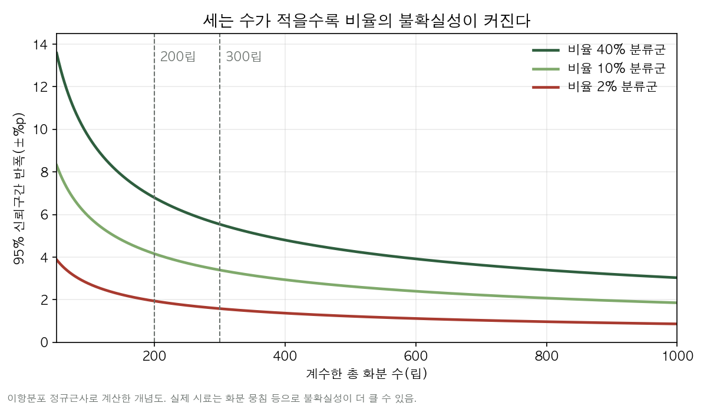
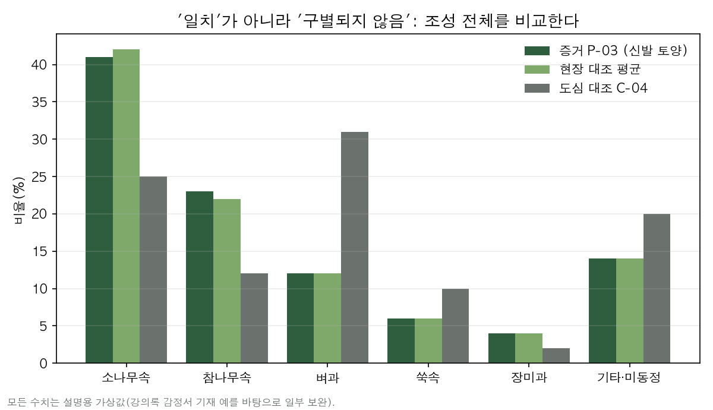

봄에 산책을 다녀오면 옷과 머리카락에 꽃가루가 묻습니다. 대부분은 눈에 보이지도 않고, 묻었다는 사실조차 모릅니다. 수사에서는 바로 이 점이 중요합니다. **본인이 모르는 사이에 묻고, 잘 털리지 않으며, 오래 남는 흔적**이기 때문입니다.

이 글은 법식물학 강의 6주차 내용을 바탕으로, 관련 문헌과 사례를 추가로 조사해 정리한 스터디 노트입니다. 이번 주제는 화분(꽃가루)과 포자를 다루는 **화분학(palynology)**, 그리고 이것을 수사에 쓰는 **법화분학(forensic palynology)** 입니다.

## 왜 화분인가

화분이 증거로 쓰이는 이유는 네 가지 성질이 한꺼번에 겹치기 때문입니다. Mildenhall, Wiltshire, Bryant(2006)는 화분과 포자의 유용성을 **풍부함, 산포 방식, 기계적·화학적 내구성, 미세한 크기, 형태**의 조합으로 설명합니다.

- **작다**: 대개 10~100 μm라서 육안으로 보이지 않습니다. 범인이 의식적으로 지우기 어렵습니다.
- **많다**: 꽃이 피는 철에는 공기 중에 엄청난 양이 떠다닙니다.
- **단단하다**: 바깥벽(외벽, exine)의 주성분인 **스포로폴레닌(sporopollenin)** 은 강산과 강염기에도 잘 분해되지 않습니다.
- **식물마다 모양이 다르다**: 외벽의 구멍과 무늬가 분류군마다 달라서 현미경으로 어느 식물의 화분인지 좁힐 수 있습니다.

다만 강의에서 가장 강조한 핵심은 따로 있습니다.

> 법화분학의 증거 가치는 "어떤 화분이 있는가"보다 "**어떤 화분들이 어떤 비율로 함께 있는가**"에서 나옵니다. 한 종류의 화분만으로 결론을 내리지 않습니다.
{: .prompt-info }

## 화분의 구조와 형태 용어

화분은 수술의 꽃밥 안에서 감수분열로 만들어지는, 아주 작은 수컷 배우체입니다. 대부분은 한 알씩 흩어지지만(단립), 두 알·네 알이 붙어 다니는 식물도 있습니다.

화분벽은 두 겹입니다. 안쪽 **내벽(intine)** 은 셀룰로스와 펙틴이라 쉽게 분해되고, 바깥 **외벽(exine)** 은 스포로폴레닌이라 남습니다. 실험실에서 유기물을 녹여내도 외벽만은 남는 이유가 여기 있습니다.

동정(식물 이름 붙이기)에 쓰는 형질은 다음과 같습니다.

| 형질 | 무엇을 보나 | 예 |
|---|---|---|
| 크기 | 지름(대개 10~100 μm) | 호박류는 100 μm 이상으로 매우 큼 |
| 모양·방향 | 극축과 적도 기준, 극면관·적도면관 | 구형, 타원형, 삼각형 |
| 발아구(aperture) | 화분관이 나오는 자리 | 구(colpus, 긴 홈), 공(porus, 둥근 구멍), 구공(colporus) |
| 외벽 무늬 | 표면 장식 | 국화과 가시상, 백합류 망상 |
| 특수 구조 | 공기주머니, 점착 물질 | 소나무속의 공기주머니 2개 |

벼과는 공이 1개, 해바라기는 구공이 3개, 소나무는 몸통 양쪽에 공기주머니가 달린 모양이라 입문 단계에서도 구별이 쉽습니다. 반대로 경계가 모호한 경우도 있습니다. 빈 대학 계열의 화분 데이터베이스 PalDat을 보면, 아주 짧은 구공을 "공으로 해석할 수도 있다"고 적어둔 항목이 여럿 있습니다. 형태 용어는 엄밀한 정의라기보다 관찰자의 판단이 끼어드는 기재라는 점을 기억해 둘 만합니다.

## 풍매화와 충매화: 증거 해석의 출발점

화분이 어떻게 이동하느냐는 해석에 직접 영향을 줍니다.

| 구분 | 풍매화 | 충매화 |
|---|---|---|
| 화분의 양 | 매우 많음 | 비교적 적음 |
| 성질 | 가볍고 건조, 표면 매끈한 편 | 끈적하고 가시·돌기 많음 |
| 산포 범위 | 넓음(수 km 이상도) | 좁음(꽃 근처) |
| 예 | 소나무, 참나무, 오리나무, 벼과, 쑥, 돼지풀 | 장미과, 콩과, 국화과 다수, 호박 |
| 증거로서 | 배경 화분, 지역·계절 단서 | 발견되면 근접 접촉 시사 |

그래서 **소나무·참나무 화분이 많이 나왔다는 것만으로는 장소를 특정하기 어렵습니다**. 우리나라 어디서나 봄이면 날리는 화분이기 때문입니다. 반대로 원래 적게 만들어지고 멀리 날지 않는 충매화 화분이 옷에 많이 묻어 있다면, 그 식물과 직접 닿았을 가능성이 높아집니다.

포자도 같은 논리로 씁니다. 양치식물 포자(한 줄 홈 또는 Y자 홈)는 습한 숲, 이끼 포자는 습지나 바위, 곰팡이 포자는 부패나 실내 환경의 단서가 됩니다. 버섯 포자는 독버섯 중독 사건의 위 내용물 검사에서 중요해서 뒤 주차에서 다시 다룹니다.

### 계절성: 국내 공중화분 자료

화분은 식물마다 날리는 시기가 달라 계절의 단서가 됩니다. 1997~2007년 서울·제주 등 7개 지점에서 공중화분을 측정한 국내 연구(박기준 외, 2008)에 따르면 꽃가루는 주로 2~11월에 관측되고, **수목 화분은 3~5월, 잡초 화분은 8~10월에 정점**입니다. 수목은 소나무·참나무·오리나무·자작나무, 잡초는 환삼덩굴·쑥·돼지풀이 주를 이루며, 소나무가 수목 화분의 약 70%를 차지했습니다. 제주는 삼나무 화분이 두드러졌습니다.

이 연구는 알레르기·기상 분야의 연구이지 법과학 연구는 아닙니다. 그래도 "봄 화분인지 가을 화분인지"를 판단할 때 국내 기준선 역할을 할 수 있습니다. 다만 토양에는 여러 해의 화분이 쌓여 있어서, 토양에서 나온 계절 화분이 "올해 그 계절"을 뜻하지는 않습니다.

## 시료 채취와 오염 방지

화분은 너무 작아서 **채취하는 사람 자신이 오염원**이 되기 쉽습니다. 강의에서 정리한 원칙은 이렇습니다.

- **의류·신발은 통째로 종이 봉투에** 담아 실험실로 가져갑니다. 현장에서 털거나 테이프를 붙이면 화분이 날아가거나 섞입니다.
- **토양은 표면 몇 cm**를 채취하고, 지점마다 도구를 바꾸며 위치와 깊이를 기록합니다.
- **이끼 덩어리**는 화분을 잘 붙잡아 두어 그 장소의 장기 누적 조성을 보여줍니다.
- **대조 시료는 세 겹**으로 설계합니다. 증거 지점, 그 주변, 그리고 먼 지점입니다.
- 실험실에서는 **공시험(blank) 슬라이드**를 함께 만들고, 증거 시료와 대조 시료는 다른 날·다른 작업대에서 처리하거나 증거 시료를 먼저 처리합니다.

대조 시료가 왜 필수인지는 영국 법화분학자 Wiltshire(2006)의 지적이 잘 보여줍니다. 모든 장소는 고유해서 "이 지역의 화분 조성은 대략 이렇다"라는 모집단 자료를 미리 만들어 둘 수 없고, **현장에서 직접 얻은 분석 자료 없이 법정 반대신문을 견디기는 어렵다**는 것입니다.

## 처리, 동정, 계수

### 처리: 화분만 남기기

흙이나 옷 부착물에는 광물 입자, 식물 조각, 섬유가 섞여 있습니다. 처리의 목적은 이것들을 걷어내고 화분을 농축하는 것입니다. 원리는 다섯 단계로 정리됩니다.

1. **분산**: 물과 약한 알칼리로 덩어리를 풀어 화분을 입자에서 떼어냅니다.
2. **체질**: 너무 큰 조각과 너무 작은 입자를 걸러냅니다.
3. **유기물 제거**: 셀룰로스 같은 식물 조직을 화학적으로 분해합니다. 스포로폴레닌 외벽은 남습니다.
4. **광물 제거**: 밀도 차이로 가라앉히거나 산으로 녹입니다.
5. **염색과 봉입**: 외벽 무늬가 잘 보이게 물들여 슬라이드를 만듭니다.

3단계의 대표적인 방법이 Erdtman(1960)이 정리한 **아세톨리시스(acetolysis)** 입니다. 무수아세트산과 진한 황산을 9:1로 섞어 가열하면 셀룰로스와 세포 내용물이 분해되고 외벽만 깨끗하게 남습니다. 오늘날 공개 프로토콜들도 같은 비율을 쓰며, 가열 온도와 시간은 기관마다 조금씩 다릅니다.

> 화분 처리에는 강산·강알칼리, 경우에 따라 불산처럼 매우 위험한 시약이 쓰입니다. 환기 설비와 보호 장비를 갖춘 전문 시설에서 훈련받은 사람만 수행합니다. 강의 실습도 위험 시약 없이 습식 마운트와 시판 슬라이드로 진행합니다.
{: .prompt-warning }

### 동정: 대부분 과·속 수준까지

슬라이드의 화분을 크기·모양·발아구·외벽 무늬로 기재하고, 참고 슬라이드·도감·PalDat 같은 데이터베이스와 비교합니다. 현실적으로 **대부분은 과(family)나 속(genus)까지만** 동정됩니다. 벼과 화분은 종을 구별하기 어렵고, 소나무도 보통 "소나무속"으로 보고합니다. 이 한계는 보고서에 분명히 써야 합니다.

### 계수: 왜 300립인가

슬라이드를 정해진 방식으로 훑으며 화분을 세어 분류군별 비율을 냅니다. 강의록은 "통상 수백 립 이상"이라고 했고, 실습에서는 200립 이상을 셉니다.

흔히 듣는 "300립"이라는 기준은 어디서 왔을까요? Weng과 Hooghiemstra(2024)는 시료당 최소 300립을 세는 관행이 **이론적 계산보다는 앞선 연구자들의 경험에서 나온 것**이라고 지적합니다. 그들의 분석으로는 300립이면 비율 10% 이상인 분류군을 추정하는 데는 대체로 충분하지만, **드문 분류군은 더 많이 세야** 하고 모든 경우에 맞는 정답 숫자는 없습니다.

_이항분포 정규근사로 계산한 개념도입니다. 비율 40%인 분류군의 95% 신뢰구간 반폭은 200립에서 약 ±6.8%p, 300립에서 약 ±5.5%p입니다._

의료영상 AI에서 테스트셋이 작으면 정확도의 신뢰구간이 넓어지는 것과 똑같은 이야기입니다. 화분 수가 적은 시료끼리의 비교는 우연에 의한 흔들림이 커서, 몇 %p 차이로 "다르다/같다"를 말하기 어렵습니다. 그래서 **총 계수와 방법을 반드시 함께 보고**합니다.

## 실제 사례

### 1959년 오스트리아: 장화의 진흙

비엔나 근처 다뉴브 여행 중 한 남성이 실종됐고, 동기가 있는 용의자가 있었지만 시신이 없었습니다. 빈 대학의 Wilhelm Klaus가 용의자 장화의 진흙을 분석했더니 현생 가문비나무·버드나무·오리나무 화분과 함께, 약 2천만 년 전 마이오세 지층에서 씻겨 나온 히코리 **화석 화분**이 나왔습니다. 이 조합이 나올 수 있는 곳은 비엔나 근처의 좁은 지역뿐이었고, 용의자는 자백한 뒤 그 지역에서 시신 위치를 안내했다고 전해집니다(Texas A&M 대학 블로그 글 기준). 강의록은 이 사례를 "1950년대 오스트리아"로 소개하며, 흔히 첫 사례로 꼽힌다고 덧붙입니다.

### 뉴질랜드: 뒷문의 Hypericum 덤불

Mildenhall(2006)이 보고한 사건입니다. 두 침입자가 집에 들어왔다가 도망치며 재킷을 두고 갔고, 한 명이 재킷을 찾으러 돌아오다 뒷문 밖의 꽃 핀 **Hypericum(물레나물속) 덤불**을 스쳤습니다. 다음 날 압수한 용의자 옷에서 Hypericum 화분이 트랙팬츠 14%, 데님 재킷 24%, 폴로셔츠 27.5%를 차지했습니다.

결정적인 점은 비율만이 아니었습니다. 화분 대부분이 **세포 내용물이 남은 채 덩어리로** 붙어 있어서, 공기 중에서 날아온 것이 아니라 최근 직접 접촉한 흔적과 맞았습니다. 덤불의 화분과 색·모양·발달 상태·크기 범위도 같았습니다. 그리고 30년간의 뉴질랜드 감정 경험에서 Hypericum은 옷에서 미량으로만 나왔다고 합니다. 그럼에도 저자는 **화분 증거는 본질적으로 정황 증거라 단독으로 유죄를 가리기 어렵다**고 분명히 적었습니다.

### 7 m 떨어진 두 장소

Horrocks와 Walsh(1999)의 사건은 강의 핵심 개념의 교과서 같은 예입니다. 범행 현장(골목)과 용의자가 주장한 알리바이 장소(진입로 옆)는 **불과 7 m** 떨어져 있었습니다. 그런데도 식생 차이 때문에 토양 화분 조성이 유의하게 달랐습니다. 흥미로운 점은 차이가 "어떤 화분이 있느냐"가 아니라 **같은 종류 화분들의 양(비율)** 에서 나타났다는 것입니다. 용의자 옷의 흙은 알리바이 장소가 아니라 범행 현장과 강하게 상관했습니다.

_강의록의 감정서 기재 예를 바탕으로 만든 가상 수치입니다. 증거 시료는 현장 대조와 구별되지 않고, 도심 대조와는 벼과 비율에서 뚜렷이 다릅니다._

### 보스니아: 옮겨진 유해의 원래 자리

Brown(2006)은 구유고 국제형사재판소(ICTY)가 1997~2002년 동북 보스니아에서 진행한 발굴에 참여했습니다. 1995년 7월 스레브레니차 함락 뒤 만들어진 1차 집단 매장지 7곳은 약 3개월 뒤 은밀히 파헤쳐졌고, 유해는 여러 2차 매장지로 옮겨졌습니다. 연구팀은 화분과 토양·퇴적물로 1차 매장지마다 **'환경 프로필'** 을 만들고, 2차 매장지 유해에 함께 딸려 온 흙을 대조했습니다. 24곳 이상에서 240개 넘는 시료를 검사하고 화분 하위시료 65개를 정밀 분석했으며, X선 회절 광물 분석과 탄도·의류 증거까지 함께 맞춰 보았습니다. 이 증거는 실제 재판에 쓰였습니다.

### 마그데부르크: 비강 속 질경이 화분

1994년 독일 마그데부르크 공사 현장에서 32구의 유골이 나왔습니다. Szibor 등(1998)은 두개골 21개의 **비강**을 씻어냈고, 그중 7개에서 질경이 화분이 많이, 피나무와 호밀 화분이 조금 나왔습니다. 모두 6~7월에 날리는 화분이라 사망 시기를 여름으로 추정했습니다. 언론 보도는 이 결과가 1945년 봄보다 1953년 6월 동독 봉기 직후의 처형이라는 설을 지지한다고 전했지만, 역사적 귀속은 화분만으로 확정된 것이 아닙니다.

## 한계와 과대 해석 주의

> 화분 증거는 "그 사람이 현장에 있었다"를 입증하지 않습니다. **가능성의 범위를 좁히는 증거**입니다. 다른 장소에서 같은 화분이 묻었을 가능성을 배제하지 못했다면 감정서에 그 사실을 적어야 합니다.
{: .prompt-warning }

- **"일치한다" 대신 "일관된다", "구별되지 않는다"** 라고 씁니다. 같은 식생대라면 다른 지점에서도 비슷한 조성이 나옵니다.
- **음성 결과는 방문을 배제하지 못합니다.** 화분이 없거나 적은 것은 세탁, 시간 경과, 채취 방식 탓일 수 있습니다.
- **계절 화분의 함정**: 토양은 여러 해의 화분이 누적되고, 옷은 세탁·보관 이력의 영향을 받습니다.
- **실내 시료**: 실내 먼지에는 바깥 화분이 이미 들어와 있습니다.
- **오래된 화분**: 침식·변색된 화분은 지층에서 재퇴적된 것일 수 있습니다. 오스트리아 사례처럼 이것이 오히려 단서가 되기도 하지만, 해석을 복잡하게 만들기도 합니다.
- **저활용과 검증 부족**: Bryant와 Jones(2006)는 미국에서 법화분학이 전문가와 교육기관 부족으로 거의 쓰이지 않는다고 했고, Walsh와 Horrocks(2008)는 노동집약성·전문성 부족과 함께 **검증 연구와 독립 숙련도 시험의 필요성**을 지적했습니다. 국내에서는 법과학 목적의 화분 분석 연구나 감정 보고를 이번 조사에서 찾지 못했습니다.

1주차에서 다룬 Max Frei 사례처럼, 대조 시료 없이 한두 종류 화분에 기대거나 오염 점검을 생략한 해석은 신뢰를 잃습니다. 참고로 최근에는 화분 DNA 메타바코딩으로 동정 해상도를 높이려는 연구도 있지만, 이 강의는 형태 동정에 집중합니다.

## 정리

> - 화분의 힘은 **작고, 많고, 단단하고, 모양이 다르다**는 조합에서 나옵니다.
> - 해석의 단위는 한 종류가 아니라 **조성(비율의 묶음)** 이고, 반드시 **현장 대조 시료**와 비교합니다.
> - 풍매화는 배경, 충매화는 근접 접촉의 단서입니다.
> - 300립은 경험칙입니다. 계수 총수와 방법을 함께 보고합니다.
> - 결론은 "현장에 있었다"가 아니라 "현장 조성과 일관된다"입니다.
{: .prompt-tip }

결국 법화분학은 의료영상 AI의 외부 검증과 닮았습니다. 한 장의 예쁜 결과보다 **무엇과 비교했는지, 몇 개를 셌는지, 무엇을 배제하지 못했는지**가 신뢰를 결정합니다.

## 참고문헌

- 강의록: 법식물학 6주차 강의록, 「화분학(Palynology)과 포자」.
- Mildenhall, D. C., Wiltshire, P. E. J., & Bryant, V. M. (2006). Forensic palynology: why do it and how it works. *Forensic Science International*, 163(3), 163–172. <https://doi.org/10.1016/j.forsciint.2006.07.012>
- Mildenhall, D. C. (2006). Hypericum pollen determines the presence of burglars at the scene of a crime: an example of forensic palynology. *Forensic Science International*, 163(3), 231–235. <https://doi.org/10.1016/j.forsciint.2005.11.028>
- Mildenhall, D. C. (2006). An unusual appearance of a common pollen type indicates the scene of the crime. *Forensic Science International*, 163(3), 236–240. <https://doi.org/10.1016/j.forsciint.2005.11.029>
- Wiltshire, P. E. J. (2006). Consideration of some taphonomic variables of relevance to forensic palynological investigation in the United Kingdom. *Forensic Science International*, 163(3), 173–182. <https://doi.org/10.1016/j.forsciint.2006.07.011>
- Bryant, V. M., & Jones, G. D. (2006). Forensic palynology: current status of a rarely used technique in the United States of America. *Forensic Science International*, 163(3), 183–197. <https://doi.org/10.1016/j.forsciint.2005.11.021>
- Brown, A. G. (2006). The use of forensic botany and geology in war crimes investigations in NE Bosnia. *Forensic Science International*, 163(3), 204–210. <https://doi.org/10.1016/j.forsciint.2006.05.025>
- Szibor, R., Schubert, C., Schöning, R., Krause, D., & Wendt, U. (1998). Pollen analysis reveals murder season. *Nature*, 395, 449–450. <https://doi.org/10.1038/26646>
- Horrocks, M., & Walsh, K. A. J. (1998). Forensic palynology: assessing the value of the evidence. *Review of Palaeobotany and Palynology*, 103(1–2), 69–74. <https://doi.org/10.1016/S0034-6667(98)00027-X>
- Horrocks, M., & Walsh, K. A. J. (1999). Fine resolution of pollen patterns in limited space: differentiating a crime scene and alibi scene seven meters apart. *Journal of Forensic Sciences*, 44(2), 417–420. <https://doi.org/10.1520/JFS14477J>
- Walsh, K. A. J., & Horrocks, M. (2008). Palynology: its position in the field of forensic science. *Journal of Forensic Sciences*, 53(5), 1053–1060. <https://doi.org/10.1111/j.1556-4029.2008.00802.x>
- Weng, C., & Hooghiemstra, H. (2024). How many pollen grains should we count? A basic statistical view. *Review of Palaeobotany and Palynology*, 330, 105126. <https://doi.org/10.1016/j.revpalbo.2024.105126>
- Erdtman, G. (1960). The acetolysis method: a revised description. *Svensk Botanisk Tidskrift*, 54, 561–564. (원문 미열람, 후속 문헌의 인용으로 확인)
- 박기준, 김헌애, 김규랑, 오재원, 이선영, 최영진 (2008). 한반도 지역에서 관측된 꽃가루 농도 특성에 관한 연구. *한국농림기상학회지*, 10(4), 167–176.
- Texas A&M University, Liberal Arts blog. A silent witness: how analysis of pollen can solve crimes. <https://liberalarts.tamu.edu/blog/a-silent-witness-how-analysis-of-pollen-can-solve-crimes/>
- Discover Magazine. Of flowers and murder. <https://discovermagazine.com/planet-earth/of-flowers-and-murder>
- PalDat – Palynological Database. <https://www.paldat.org>

[발표자료 (PPTX) 내려받기](/assets/files/forensic-botany/forensic-botany-week06.pptx)

---

**법식물학 스터디** · ← [5주차 현장 식물 증거의 채취와 보존](/posts/forensic-botany-05-field-collection-and-preservation/) | [7주차 규조류·조류와 수생 식물](/posts/forensic-botany-07-diatoms-and-aquatic-plants/) →
