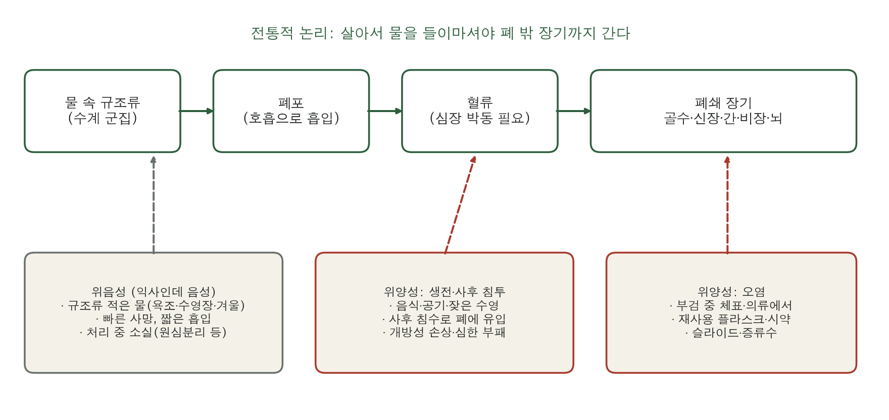
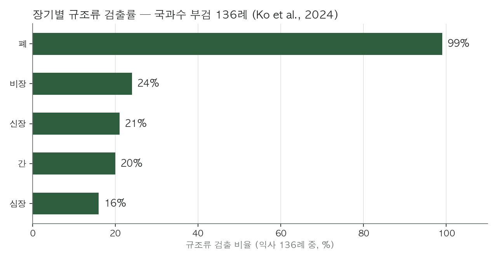

물에서 시신이 발견되면 수사에서 가장 먼저 부딪히는 질문은 단순합니다. **살아서 물에 빠져 숨진 것인가, 다른 이유로 숨진 뒤 물에 던져진 것인가.** 사고, 자살, 살인의 갈림길이 여기서 나뉩니다. 그런데 익사는 부검에서도 확정하기 어려운 사인입니다. 기도의 거품이나 폐 팽창 같은 소견은 비특이적이고, 시신이 부패하면 그나마 사라집니다.

이 공백을 메우려고 100년 넘게 쓰여 온 도구가 **규조류(diatom) 시험**입니다. 이 글은 법식물학 강의 7주차 내용을 바탕으로, 관련 문헌과 사례를 추가로 조사해 정리한 스터디 노트입니다. 이번 주제는 법의학과 직접 맞닿아 있고, 의료영상 AI와도 연결되는 지점이 있어 조금 더 깊게 파 보았습니다.

## 규조류는 어떤 생물인가

규조류는 규조식물문(Bacillariophyta)에 속하는 **단세포 진핵 조류**입니다. 가장 큰 특징은 이산화규소, 즉 유리와 같은 성분으로 된 껍질인 **피각(frustule)**입니다. 피각은 위 뚜껑(상각)과 아래 뚜껑(하각)이 비누 상자처럼 겹쳐진 구조이고, 둘 사이를 띠 모양의 환대(girdle band)가 잇습니다. 표면의 줄무늬와 작은 구멍 배열이 속과 종을 가르는 단서가 됩니다.

형태로는 크게 둘로 나눕니다.

| 구분 | 모양 | 봉선(raphe) | 주된 생활 방식 | 대표 속 |
|---|---|---|---|---|
| 중심규조 (centric) | 원형, 방사 대칭 | 없음 | 물에 떠다니는 플랑크톤 | Cyclotella, Stephanodiscus, Aulacoseira |
| 우상규조 (pennate) | 길쭉함, 좌우 대칭 | 있는 종·없는 종 | 돌·수초에 붙어 사는 부착 조류 | Navicula, Nitzschia, Gomphonema, Fragilaria |

봉선은 일부 우상규조 껍질에 난 긴 홈으로, 이 홈이 있는 종은 표면을 따라 미끄러지듯 움직입니다. 생활 방식 구분은 경향일 뿐 예외가 많습니다.

법의학에서 중요한 성질은 두 가지입니다. 첫째, **규산 껍질은 강산과 고온에도 남습니다**(불화수소산과 강알칼리는 예외). 조직을 산으로 녹여도, 부패한 시신에서도 껍질을 찾을 수 있습니다. 둘째, **수계마다 군집이 다릅니다**. 국내 연구에서도 한강 주요 익사 지점에서 봄에는 31속 111분류군, 여름에는 22속 87분류군이 확인됐고, 봄과 여름의 우점 지표종(*Stephanodiscus hantzschii* f. *tenuis*, *Cyclotella atomus*)이 서로 달랐습니다(이경락 등, 2011).

## 시험의 논리: 심장이 뛰어야 장기까지 간다

_규조류 시험의 전통적 논리(위)와 위음성·위양성이 끼어드는 경로(아래). 강의록과 문헌을 바탕으로 직접 그린 도식입니다._

살아 있는 사람이 물속에서 숨을 쉬면 물이 폐로 들어갑니다. 폐포 벽이 손상되면 물속 작은 입자가 혈류로 들어가고, **심장이 아직 뛰고 있으면** 혈류를 타고 신장, 간, 골수, 뇌 같은 폐쇄 장기(closed organ)까지 퍼집니다. 반대로 사망 뒤 물에 들어간 시신은 순환이 없으니 폐에는 물이 스며들어도 폐 밖 장기까지 가기 어렵습니다. 그래서 **폐만 양성인 결과는 약하고, 폐쇄 장기 양성이 핵심**이라는 것이 전통적 논리입니다(Hendey, 1973; Pachar & Cameron, 1993).

익사 진단에 규조류를 처음 쓴 것은 1904년 Revenstorf로 알려져 있습니다(허기영, 2020).

## 실험실 처리: 유기물은 녹이고 유리 껍질만 남긴다

원리는 단순합니다. 조직의 유기물을 없애고 규산 껍질만 농축하는 것입니다.

1. **분해**: 질산 같은 강산으로 가열 분해하거나(산 분해), proteinase K 같은 단백질 분해 효소로 조직을 풉니다(효소 분해). 마이크로파 분해는 질산·과산화수소를 밀폐 용기에서 마이크로파로 가열하는 **산 분해의 변형**입니다.
2. **농축**: 원심분리와 증류수 세척을 반복합니다.
3. **관찰**: 고굴절률 봉입제로 슬라이드를 만들고 위상차·미분간섭 현미경으로 400~1,000배에서 봅니다.

방법마다 장단점이 있습니다. 질산법은 싸고 널리 쓰이지만 약한 껍질을 파괴해 위음성을 만들 수 있습니다(Zhou et al., 2020). 국내에서는 가거도 해수를 대상으로 proteinase K 효소법이 질산법보다 회수율이 높고 껍질 형태도 잘 보존된다는 보고가 있습니다(Hong et al., 2012). 원심분리 자체도 손실 요인입니다. 4,000 rpm에서 15분 원심분리하면 규조류의 약 34%가 상층액으로 빠져나간다는 측정이 있고, 이를 피하려고 진공 여과와 자동 주사전자현미경을 결합한 MD-VF-Auto SEM 방법이 나왔습니다(Zhao et al., 2013).

> 산 분해는 가열한 강산을 쓰는 위험한 작업입니다. 흄 후드와 폐액 처리 시설을 갖춘 기관에서 훈련된 담당자만 수행합니다.
{: .prompt-warning }

## 판정 기준: 합의된 숫자가 없다

이 시험의 가장 큰 약점은 **"몇 개 나와야 양성인가"에 대한 합의가 없다**는 점입니다. 연구자마다 제시한 기준을 모아 보면 이렇습니다(허기영, 2020 정리).

| 제안자 | 기준 |
|---|---|
| Auer & Möttönen (1988) | 폐 10 g, 슬라이드당 20개 이상 |
| Farrugia & Ludes | 폐 2 g 침전물 100 μL당 20개 이상, 다른 장기는 완전한 규조류 5개 초과 |
| Pollanen (1997) | 골수에서 1개 이상 |
| Zhao 등 (2016) | 폐/익수매질 규조류 수 비(L/D) 1 초과 |
| Shen 등 (2019) | 간 또는 신장 10 g당 10개 초과 |

분해법, 시료량, 계수 단위가 모두 달라 서로 비교할 수 없습니다. 2025년 17편을 묶은 체계적 문헌고찰도 같은 결론을 냈습니다. 익사자가 대조군보다 대체로 많은 규조류를 보이지만, 연구 간 결과를 비교할 수 없어 믿을 만한 기준값을 정할 수 없다는 것입니다. 17편 중 익수매질과 비교한 연구는 9편, 처리 과정에 양성 대조를 넣은 연구는 하나도 없었고, 공인 규조학자가 분류한 연구는 1편이었습니다(Tyr et al., 2025).

## 위음성과 위양성

**위음성(익사인데 음성)**은 생각보다 흔합니다. 온타리오 익사 771례를 분석한 연구에서 대퇴골 골수 양성은 담수 익사의 28%, 욕조·수영장 같은 생활용수 익사의 12%뿐이었습니다. 저자들의 표현대로 **담수 익사자 세 명 중 한 명 정도를 잡아내는 검사**입니다. 흥미롭게도 양성률은 달마다 오르내렸고, 그 주기가 담수 규조류의 대번성 시기와 맞아떨어졌습니다(Pollanen et al., 1997). 규조류가 적은 물, 겨울철, 짧은 흡입 후 빠른 심정지, 처리 중 손실이 모두 위음성의 원인입니다.

**위양성(익사가 아닌데 양성)**은 더 까다롭습니다. 원인은 세 갈래입니다.

- **생전 유입**: 음식, 공기, 잦은 수영이나 잠수로 몸에 들어온 규조류.
- **사후 침투**: 오래 잠겨 있거나, 수압이 높거나, 상처나 부패로 체강이 열린 경우.
- **오염**: 부검 중 체표·의류에서, 재사용한 실험 기구, 시약, 증류수, 심지어 일회용 슬라이드에서.

기구 오염은 실측된 문제입니다. 일본 미야자키대 연구진은 강산 분해에 재사용하던 Kjeldahl 플라스크 60개 중 17개에서 위양성이 나왔고 최대 290개까지 검출됐다고 보고했습니다. 새 플라스크만 써서 다시 검사하자 **신장·간에서 다량 검출된 익사 의심 사례는 76례 중 1례(1.3%)**로 줄었고, 1~2개 수준의 소량 검출은 비익사·욕조 익사군(27%)에서 오히려 더 흔했습니다. 음성 대조 플라스크에서도 80례 중 3례에서 1~2개가 나왔습니다. 연구진은 폐쇄 장기의 소량 검출은 위양성과 구별하기 어렵고, 오히려 **폐의 다량 검출이 진단에 더 유용하다**고 결론지었습니다(Sonoda et al., 2022). 같은 연구진의 2026년 후속 연구는 고도로 부패한 시신에서 큰 오염이 **부검 중 조직 채취 단계**에서 생기기 쉽다고 보고했습니다(Kakizaki et al., 2026).

반대 방향의 증거도 있습니다. 핀란드 연구진은 비익사 시신 14구를 표준화된 방법으로 검사해 6구에서 총 9개의 규조류만 찾았고, 각 시신에서 양성 장기는 하나뿐이었습니다. 시신 5구의 기관에 규조류 배양액 3.5 L를 직접 넣은 실험에서도 흉강과 좌심 혈액에만 소수가 보였고 내부 장기에서는 나오지 않았습니다(Lunetta et al., 2013). 사후에 넣은 물이 장기까지 가기는 어렵다는 고전적 논리를 지지하는 결과입니다.

> 강의록의 토론 질문 "폐에서만 많이 나오고 신장·간에서는 안 나왔다면?"에 대한 답이 문헌에 따라 달라지는 이유가 여기에 있습니다. 전통적 관점에서는 폐 단독 양성이 약한 증거지만, 오염을 엄격히 통제한 최근 일본 연구는 폐의 정량 결과를 더 신뢰합니다.
{: .prompt-info }

## 실제 사례와 국내 실무

### 사례 1. 자창 사망 후 유기된 시신의 위양성 (대한법의학회지, 2022)

30세 여성이 12월 중순 집에서 동생에게 흉기로 여러 차례 찔려 숨졌고, 약 열흘 뒤 서해안의 한 섬 농수로(폭 약 3 m, 깊이 약 1.5 m)에 버려졌습니다. 시신은 사망 약 4개월 뒤 발견됐습니다. 등의 자창 여러 곳이 흉강과 복강을 관통해 폐, 내림대동맥, 비장, 위가 손상된 상태였습니다. 통상의 강산법으로 검사하자 폐에서 13속 2,898개/g, 간 11개/g, 신장 16개/g, 심장 40개/g이 나왔고, 속 구성도 현장 물과 비슷했습니다. 숫자만 보면 전형적인 익사 양성입니다. 그러나 사인은 흉부 자창이었고, 저자들은 **자창을 통해 사후에 규조류가 침투한 위양성**으로 판단했습니다(하홍일·심윤택, 2022). 이 논문은 국내 부검 실무에서 대부분의 수중 시신에 규조류 검사를 일상적으로 시행한다고 적고 있습니다.

### 사례 2. 국과수 부검 136례의 장기별 검출률 (2024)

_국과수 부산과학수사연구소의 익사 부검 136례에서 장기별 규조류 검출 비율(Ko et al., 2024의 수치로 직접 그림)._

국립과학수사연구원 연구진은 2021~2022년 익사 136례와 물과 무관한 대조 21례에서 폐, 비장, 신장, 간, 심장 조직을 각 30 g씩 질산으로 분해해 검사했습니다(양성 기준: 1 g당 2개 초과). 폐는 99%에서 검출됐고, 폐쇄 장기 중에서는 비장이 24%로 가장 높았습니다. 비장 양성은 익사군에서만 나와 특이도 100%였지만 민감도는 24%, 음성예측도는 17%였습니다. 주목할 점은 **부패한 시신일수록 비장·간·신장·심장 검출이 유의하게 많았다**는 것입니다. 저자들도 물에 잠긴 비익사 대조군이 없다는 한계를 인정했습니다. 즉 "비장 양성은 익사에서만 나온다"는 결론은 아직 육상 대조군 기준입니다(Ko et al., 2024).

### 사례 3. 수계 비교가 맞을 때와 틀릴 때 (Pollanen, 1997)

골수 양성이면서 현장 물 시료가 있는 담수 익사 52례 중 47례(90%)에서 골수와 물의 규조류 종류가 일치했습니다. 나머지 5례는 시신이 발견된 곳이 실제 익사 장소와 멀리 떨어져 있었을 가능성이 제시됐습니다. 골수에서 나온 것은 대부분 물속에서 가장 작고 가장 흔한 종, 특히 작은 우상규조였습니다. **수계 비교는 꽤 잘 맞지만, 시신이 흘러가면 어긋난다**는 두 가지를 동시에 보여 주는 결과입니다.

## 수계 비교와 수생 식물 증거

수계 비교는 사체 시료와 후보 수계의 군집을 놓고 공통 분류군, 상대 풍부도, 특정 수계에만 있는 희귀 분류군을 살핍니다. 스위스의 법의학·조류학 협업 절차는 종 지수와 우점 동일성 유사도 지수를 계산하고 분리값으로 결론을 내립니다(Hürlimann et al., 2000). 프랑스 스트라스부르에서는 익사가 잦은 세 지점의 물과 돌을 매달 채취해 규조류 프로파일을 만들어 두고 시신 조직과 비교했습니다(Ludes et al., 1996). 다만 장기 속 규조류는 보통 소수라 통계적 신뢰도가 낮고, 계절과 지점에 따라 군집이 바뀌므로 결과는 가능성의 범위로만 말해야 합니다.

규조류 외에도 물과의 접촉을 알려 주는 식물 증거가 있습니다. 옷이나 신발, 차량에 붙은 물수세미·붕어마름 같은 수초 조각, 신발 틈의 수생 식물 종자, 물체 표면의 녹조류·남조류 막 등입니다. 흔한 수초는 증거 가치가 낮고, 부착 생물의 성장 속도로 잠긴 시간을 추정하는 방법은 표준화가 부족합니다. 의류에 묻은 규조류도 단서가 되는데, 실험에서 토양·물에 접촉한 옷으로 규조류가 실제로 옮겨 붙었고 과산화수소 침지가 가장 효율적인 회수법이었습니다(Scott et al., 2014). 일부 남조류는 독소를 만들기 때문에 물과 관련된 중독이 의심되면 독성학 전문가와 협력합니다(강의록 기준).

참고로 플랑크톤 DNA를 PCR로 검출하는 방법도 연구되고 있지만, 이 강의의 범위 밖입니다.

## 한계와 과대 해석 주의

> 규조류 시험은 익사를 **증명**하는 검사가 아닙니다. 양성이어도 음성이어도 단독으로 사인을 결론짓지 않고, 부검 소견·정황·발견 환경과 함께 법의학자가 종합 판단합니다.
{: .prompt-warning }

정리하면 이렇게 주의해야 합니다.

- **음성은 익사를 배제하지 못합니다.** 담수 익사의 골수 양성률이 28% 수준입니다.
- **폐쇄 장기의 소량 양성은 오염과 구별하기 어렵습니다.** 공시험(blank), 새 기구, 정해진 채취 순서가 없으면 해석할 수 없습니다.
- **개방성 손상이나 심한 부패가 있으면** 폐쇄 장기 양성도 사후 침투일 수 있습니다.
- **수계 비교는 "일관된다", "구별되지 않는다"까지만** 씁니다. "일치한다"는 표현은 다른 수계의 가능성을 지웁니다.
- 2026년 비판적 리뷰는 "기전이 그럴듯하다고 법의학적으로 신뢰할 수 있는 것은 아니다"라고 정리하며, 검사 전에 질문(생전 흡입인가, X 지점인가 Y 지점인가)을 먼저 정의하고 장기, 조직 질량, 분해 조건, 계수 지표, 수계 시료, 한계를 최소 보고 항목으로 남기라고 권고합니다(Al-Najjar et al., 2026).

의료영상 AI를 하는 입장에서 보면 익숙한 구조입니다. 기준값 없는 판정, 기관마다 다른 전처리, 양성 대조가 빠진 검증, 그리고 라벨(사인) 자체의 불확실성까지 있습니다. 실제로 규조류 자동 동정에 AI를 적용하거나(허기영, 2020에서 소개), 사후 CT에서 접형동 내 액체를 U-Net으로 분할하는 국내 연구도 나왔습니다(허진행 등, 2024: 익사 34례, 평균 Dice 77.15%). 다만 전처리와 판정 기준이 표준화되지 않으면 모델도 그 불확실성을 그대로 학습합니다.

## 정리

- 규조류는 규산 껍질 덕분에 산 분해와 부패를 견디고, 수계마다 군집이 달라 익사 진단과 수계 추정에 쓰입니다.
- 논리는 "살아서 숨 쉬고 심장이 뛰어야 폐쇄 장기까지 간다"이지만, 판정 기준은 연구마다 다르고 합의가 없습니다.
- 위음성은 흔하고(골수 양성 약 28%), 위양성은 생전 유입, 사후 침투(특히 개방성 손상·부패), 기구·채취 오염에서 생깁니다.
- 국내에서는 수중 시신에 규조류 검사가 일상적으로 시행되고, 국과수 연구는 비장 검사의 의미를, 사례 보고는 자창 시신의 위양성을 보여 줍니다.
- 결론은 언제나 보조 증거입니다. 공시험, 수계 대조, 한계 기재가 빠진 규조류 결과는 증거로 쓸 수 없습니다.

## 참고문헌

- 법식물학 7주차 강의록, 「규조류·조류와 수생 식물」.
- 허기영 (2020). 익사에서 규조류 검사 방법과 신뢰도의 진전. 대한법의학회지, 44(3), 115–122. <https://www.kjlm.or.kr/journal/view.php?doi=10.7580/kjlm.2020.44.3.115>
- 하홍일, 심윤택 (2022). A false-positive diatom test in a non-drowned victim of multiple stab wounds. 대한법의학회지, 46(2), 55–58. <https://www.kjlm.or.kr/journal/view.php?doi=10.7580/kjlm.2022.46.2.55>
- Ko, Y. S., Ham, S. H., Heo, J.-H., et al. (2024). The significance of detecting diatoms in spleen tissue for the postmortem diagnosis of drowning. 대한법의학회지, 48(1), 1–6. <https://www.kjlm.or.kr/journal/view.php?number=1302>
- 허진행 등 (2024). U-Net-based automatic segmentation of sphenoid sinus fluid in drowning cases using postmortem CT images: a feasibility study. 대한법의학회지, 48(1), 7–13. <https://www.kjlm.or.kr/journal/view.php?number=1303>
- 이경락 등 (2011). Establishment of diatom profile for improving reliability of diagnosis of drowning: centered on the main drowning sites of Han River. 대한법의학회지, 35(2), 120–129. <https://www.kjlm.or.kr/journal/view.php?number=366>
- Hong, J. W., Lee, K. L., & Kim, Y. S. (2012). The comparison of plankton detection by two analysis methods in the seawater of Gageo Island. 대한법의학회지, 36(2), 144–150. <https://www.kjlm.or.kr/journal/view.php?number=338>
- Pollanen, M. S., Cheung, C., & Chiasson, D. A. (1997). The diagnostic value of the diatom test for drowning, I. Utility. *J Forensic Sci*, 42(2), 281–285. <https://pubmed.ncbi.nlm.nih.gov/9068187/>
- Pollanen, M. S. (1997). The diagnostic value of the diatom test for drowning, II. Validity. *J Forensic Sci*, 42(2), 286–290. <https://pubmed.ncbi.nlm.nih.gov/9068188/>
- Hendey, N. I. (1973). The diagnostic value of diatoms in cases of drowning. *Med Sci Law*, 13(1), 23–34. <https://pubmed.ncbi.nlm.nih.gov/4721834/>
- Pachar, J. V., & Cameron, J. M. (1993). The diagnosis of drowning by quantitative and qualitative diatom analysis. *Med Sci Law*, 33(4), 291–299. <https://pubmed.ncbi.nlm.nih.gov/8264360/>
- Ludes, B., Coste, M., Tracqui, A., & Mangin, P. (1996). Continuous river monitoring of the diatoms in the diagnosis of drowning. *J Forensic Sci*, 41(3), 425–428. <https://pubmed.ncbi.nlm.nih.gov/8656181/>
- Hürlimann, J., et al. (2000). Diatom detection in the diagnosis of death by drowning. *Int J Legal Med*, 114(1–2), 6–14. <https://pubmed.ncbi.nlm.nih.gov/11197630/>
- Lunetta, P., Miettinen, A., Spilling, K., & Sajantila, A. (2013). False-positive diatom test: a real challenge? *Leg Med (Tokyo)*, 15(5), 229–234. <https://pubmed.ncbi.nlm.nih.gov/23701706/>
- Zhao, J., Liu, C., Hu, S., He, S., & Lu, S. (2013). Microwave digestion–vacuum filtration–automated scanning electron microscopy as a sensitive method for forensic diatom test. *Int J Legal Med*, 127(2), 459–463. <https://pubmed.ncbi.nlm.nih.gov/22885954/>
- Zhao, J., et al. (2016). A quantitative comparison analysis of diatoms in the lung tissues and the drowning medium as an indicator of drowning. *J Forensic Leg Med*, 42, 75–78. <https://pubmed.ncbi.nlm.nih.gov/27266652/>
- Sonoda, A., Kakizaki, E., Shinkawa, N., Matsuda, H., & Yukawa, N. (2022). Conventional diatom testing using strong acid: (II). *Forensic Sci Int*, 341, 111510. <https://pubmed.ncbi.nlm.nih.gov/36399935/>
- Kakizaki, E., et al. (2026). Conventional diatom testing using strong acid: influence of postmortem contamination on diatoms in closed organs and lungs of highly decomposed immersed bodies. *Leg Med (Tokyo)*, 84, 102891. <https://pubmed.ncbi.nlm.nih.gov/42372400/>
- Tyr, A., Lunetta, P., Zilg, B., Winskog, C., & Heldring, N. (2025). The medico-legal interpretation of diatom findings for the diagnosis of fatal drowning: a systematic review. *Int J Legal Med*, 139(2), 729–746. <https://pmc.ncbi.nlm.nih.gov/articles/PMC11850479/>
- Zhou, Y., et al. (2020). Research advances in forensic diatom testing. *Forensic Sci Res*, 5(2), 98–105. <https://pmc.ncbi.nlm.nih.gov/articles/PMC7476611/>
- Al-Najjar, A. S., et al. (2026). Diatom analysis in drowning: a critical review of reliability, contamination, and medico-legal interpretation. *Cureus*, 18(1), e100870. <https://pmc.ncbi.nlm.nih.gov/articles/PMC12872940/>
- Scott, K. R., Morgan, R. M., Jones, V. J., & Cameron, N. G. (2014). The transferability of diatoms to clothing and the methods appropriate for their collection and analysis in forensic geoscience. *Forensic Sci Int*, 241, 127–137. <https://pubmed.ncbi.nlm.nih.gov/24915452/>

[발표자료 (PPTX) 내려받기](/assets/files/forensic-botany/forensic-botany-week07.pptx)

---

**법식물학 스터디** · ← [6주차 화분학과 포자](/posts/forensic-botany-06-forensic-palynology/)
