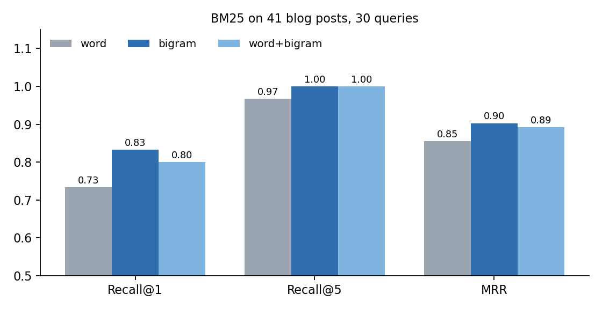

[⓪편](/posts/rag-study-00-roadmap/)에서 정한 대로, 부품을 고르기 전에 **잣대**부터 만듭니다. 이번 편에서 하는 일은 두 가지입니다.

1. 이 블로그 글 41편을 대상으로 **평가용 질문 30개**를 만든다.
2. 임베딩 없이 키워드만 쓰는 **BM25**를 직접 구현해서 기준선을 잰다.

결론부터 쓰면, BM25만으로도 정답 글이 **상위 5개 안에 30문항 전부** 들어왔습니다. 1등으로 찾은 비율은 토큰화 방식에 따라 0.73~0.83이었습니다. 다만 이 차이는 질문 3개 차이라서, 결론으로 쓰기엔 아직 작습니다.

## 1. 평가셋: 질문 30개

질문마다 **정답 글**을 하나(애매하면 둘)를 지정했습니다. 몇 가지 예시입니다.

| 질문 | 정답 글 |
|---|---|
| FDG가 세포 안에 갇히는 이유는? | PET 원리 ① |
| MLEM 반복 횟수를 늘리면 영상이 오히려 나빠지는 이유 | PET 원리 ⑧ |
| 확률이 아니라 측정값을 평균내는 앙상블 | UMUD ③ |
| 같은 학습이 두 GPU에서 동시에 돌아 결과가 오염된 사건 | RSNA 무릎 ③ |
| 손글씨를 더 잘 읽는 OCR 모델이 진단 점수를 떨어뜨렸다 | 오개념 ① |
| 랜덤 동시계수가 왜 생기고 방사능을 늘리면 어떻게 되나 | PET 원리 ⑤ 또는 ⑦ |

질문을 만들 때 지킨 규칙은 하나입니다. **제목 문구를 그대로 베끼지 않는다.** 제목이 "PET 원리 ⑧ 영상 재구성"이면 질문은 "반복 횟수를 늘리면 나빠지는 이유"처럼 본문 내용을 묻게 했습니다. 제목을 베끼면 키워드 검색이 너무 쉽게 이깁니다.

> 이 평가셋에는 분명한 한계가 있습니다. 글을 쓴 사람이 직접 만든 질문이라, 본문에 실제로 쓰인 단어를 무의식적으로 고르게 됩니다. 그래서 **키워드 검색에 유리한 쪽으로 기울어 있을 가능성**이 큽니다. 실제 사용자는 "PET에서 영상이 뿌옇게 나오는 이유" 같은 식으로 물을 텐데, 그런 질문은 ②편에서 따로 추가할 계획입니다.
{: .prompt-warning }

## 2. BM25 한 장 정리

BM25는 1990년대에 나온 키워드 검색 점수입니다. 오래됐지만 지금도 RAG의 기준선이나 Hybrid 검색의 한 축으로 계속 쓰입니다. 질문 $q$와 문서 $d$의 점수는 다음과 같습니다.

$$
\text{score}(q, d) = \sum_{w \in q} \text{IDF}(w) \cdot \frac{f(w, d)\,(k_1 + 1)}{f(w, d) + k_1 \left(1 - b + b \cdot \frac{|d|}{\text{avgdl}}\right)}
$$

식은 길지만 하는 일은 세 가지입니다.

- **IDF**: 드문 단어일수록 점수가 큽니다. "사이노그램"은 몇 편에만 나오고 "결과"는 거의 모든 글에 나오므로, 앞의 단어가 맞는 쪽이 훨씬 의미 있습니다.
- **포화($k_1$)**: 같은 단어가 10번 나온다고 1번보다 10배 관련 있는 건 아닙니다. 빈도가 늘수록 점수 증가가 점점 둔해집니다.
- **길이 보정($b$)**: 긴 글은 아무 단어나 우연히 포함하기 쉬우므로 점수를 조금 깎습니다.

구현은 30줄 정도입니다.

```python
import math
from collections import Counter
import numpy as np

class BM25:
    def __init__(self, corpus_tokens, k1=1.5, b=0.75):
        self.k1, self.b = k1, b
        self.tf = [Counter(t) for t in corpus_tokens]
        self.dl = np.array([len(t) for t in corpus_tokens], float)
        self.avgdl = self.dl.mean()
        N = len(corpus_tokens)
        df = Counter(w for t in self.tf for w in t)   # 단어별 등장 문서 수
        self.idf = {w: math.log(1 + (N - n + 0.5) / (n + 0.5)) for w, n in df.items()}

    def scores(self, q_tokens):
        s = np.zeros(len(self.tf))
        for w in set(q_tokens):
            if w not in self.idf:
                continue
            f = np.array([tf.get(w, 0) for tf in self.tf], float)
            s += self.idf[w] * f * (self.k1 + 1) / (
                f + self.k1 * (1 - self.b + self.b * self.dl / self.avgdl))
        return s
```

문서는 front matter의 제목과 본문을 합쳐 썼고, 코드 블록과 이미지 경로는 지웠습니다. 이번 편은 **글 한 편 = 문서 하나**로 찾습니다. 문단 단위로 쪼개는 일은 ③편 주제입니다.

## 3. 한국어의 문제: 조사

영어라면 공백으로 자르면 끝입니다. 한국어는 그렇지 않습니다. "감쇠 보정은 CT로 어떻게 하나"를 공백으로 자르면 이렇게 됩니다.

```
['감쇠', '보정은', 'ct로', '어떻게', '하나']
```

실제로 정답 글인 PET 원리 ⑦(보정)에는 "보정**은**"이라는 형태가 한 번도 나오지 않습니다. 공백으로만 자르면 핵심 단어인 "보정"이 아예 맞지 않는 것입니다. 해결책은 크게 셋입니다.

1. **형태소 분석기**(Kiwi, Mecab 등)로 조사를 떼어 낸다. 가장 정석입니다.
2. **글자 n-gram**: 한글 단어를 두 글자씩 겹쳐 자른다. 사전이 필요 없습니다.
3. 임베딩 모델에 맡긴다. ②편 주제입니다.

이번에는 의존성 없이 할 수 있는 2번을 먼저 해 봤습니다. 같은 질문을 bigram으로 자르면 이렇게 됩니다.

```
['감쇠', '보정', '정은', 'ct', 't로', '어떻', '떻게', '하나']
```

"보정"이 살아났습니다. 대신 "정은", "t로" 같은 의미 없는 조각도 생깁니다. 이런 조각은 여러 문서에 흩어져 있어 IDF가 낮으니, BM25가 알아서 덜 믿을 것이라는 게 기대입니다.

비교한 토큰화는 세 가지입니다.

- **word**: 공백·기호 기준으로 자르고 소문자로 바꾼다.
- **bigram**: 한글이 들어간 단어는 두 글자씩 겹쳐 자르고, 영어·숫자는 그대로 둔다.
- **word+bigram**: 두 토큰 목록을 그냥 이어 붙인다.

## 4. 결과


_41편, 질문 30개, $k_1=1.5$, $b=0.75$. Recall@k는 정답 글이 상위 k개에 들어간 질문의 비율입니다._

| 토큰화 | Recall@1 | Recall@5 | MRR |
|---|---|---|---|
| word | 0.733 (22/30) | 0.967 (29/30) | 0.855 |
| **bigram** | **0.833 (25/30)** | **1.000 (30/30)** | **0.903** |
| word+bigram | 0.800 (24/30) | 1.000 (30/30) | 0.892 |

bigram이 가장 좋았습니다. 그런데 이 차이를 얼마나 믿어도 될까요?

- 30문항 중 **23문항은 순위가 똑같았습니다.** bigram이 나은 질문이 4개, 못한 질문이 3개입니다.
- MRR 차이(bigram − word)를 질문 단위로 부트스트랩하면 95% 구간이 **[−0.036, +0.139]**로 0을 포함합니다.

그래서 이번 편의 결론은 "bigram이 낫다"가 아니라 **"bigram이 word보다 나쁘지는 않아 보이고, 사전 없이 조사 문제를 일부 덮는다"** 정도입니다. 질문이 더 늘면 다시 잽니다.

word+bigram이 bigram보다 조금 낮은 것도 같은 맥락입니다. 1문항 차이라서 의미를 두기 어렵습니다.

### 파라미터는 얼마나 중요한가

bigram에서 $k_1$과 $b$를 바꿔 봤습니다.

| | $b=0.3$ | $b=0.75$ | $b=1.0$ |
|---|---|---|---|
| $k_1=0.9$ | 0.834 | 0.864 | 0.869 |
| $k_1=1.2$ | 0.851 | 0.886 | 0.903 |
| $k_1=1.5$ | 0.873 | **0.903** | 0.886 |
| $k_1=2.0$ | 0.890 | 0.908 | 0.903 |

_값은 MRR입니다._

$b$를 0.3으로 낮추면(길이 보정을 약하게 하면) 일관되게 나빠졌습니다. 이 블로그는 글 길이 차이가 큽니다. bigram 토큰 수로 가장 짧은 글(RAG 튜토리얼, 약 600개)과 가장 긴 글(UMUD ⑤, 약 4,300개)이 7배 넘게 차이 납니다. 길이 보정을 약하게 하면 긴 글이 아무 질문에나 걸리기 쉬워지는 것으로 보입니다. 나머지 영역에서는 0.86~0.91 사이로 비슷합니다. 30문항으로 최적값을 고르면 평가셋에 과적합되기 쉬우므로, 흔히 쓰는 기본값 $k_1=1.5$, $b=0.75$를 그대로 두겠습니다.

## 5. 틀린 질문 읽기

숫자보다 이 부분이 더 배울 게 많았습니다. bigram에서 1등을 놓친 5문항입니다.

| 질문 | 정답 순위 | 1등으로 나온 글 |
|---|---|---|
| 감마선 두 개가 정확히 180도로 나가지 않는 현상 | 2 | PET 사이노그램 전처리 |
| 직선 하나를 거리와 각도 두 숫자로 나타내는 표 | 2 | PET 원리 ⑤ 동시계수와 LOR |
| Radon 변환과 포아송 노이즈로 학습용 사이노그램 만들기 | 3 | PET 원리 ⑥ Sinogram |
| 화면마다 평가자가 쓴 축척이 다르다는 발견 | 4 | UMUD ① |
| 손글씨를 더 잘 읽는 OCR 모델이 진단 점수를 떨어뜨렸다 | 2 | 오개념 ⓪ 개요 |

다섯 개 모두 **같은 시리즈 안의 이웃 글**에 졌습니다. 패턴은 두 가지였습니다.

**① 단어는 같은데 초점이 다르다.** "직선 하나를 거리와 각도로"는 ⑥편의 핵심 내용이지만, ⑤편도 LOR(직선)을 다루므로 "직선"이 훨씬 많이 나옵니다. BM25는 단어가 *얼마나* 나오는지만 보지, 그 글이 그 내용을 *설명하는* 글인지는 모릅니다.

**② 개요 글이 모든 키워드를 조금씩 갖고 있다.** 오개념 ⓪편은 시리즈 전체를 소개하므로 "OCR", "진단", "점수"가 다 들어 있습니다. 시리즈 개요나 목차 페이지는 키워드 검색에서 늘 이렇게 끼어듭니다. 지금 쓰고 있는 이 RAG 스터디 ⓪편도 나중에 같은 문제를 일으킬 겁니다.

그리고 하나는 **평가셋의 문제**였습니다. "Radon 변환과 포아송 노이즈로 사이노그램 만들기"의 정답은 전처리 글로 지정했지만, ⑥편도 Radon 변환을 설명합니다. 사람이 봐도 둘 다 답이 될 만합니다. 정답 지정이 너무 좁았던 셈입니다. 평가셋을 늘릴 때는 이런 질문에 정답을 둘 이상 허용하도록 고치겠습니다.

> RAG에서는 이 실패들이 생각보다 덜 치명적일 수 있습니다. 보통 상위 3~5개 문서를 LLM에 같이 넘기기 때문에, 정답이 2등이어도 LLM은 그 글을 봅니다. 그래서 Recall@1보다 **Recall@k(k = LLM에 넘길 개수)**가 더 직접적인 지표입니다. 반대로, 이웃 글이 1등을 차지하면 LLM이 *그럴듯하지만 다른 실험의 숫자*를 인용할 위험이 있습니다. 이 블로그처럼 비슷한 실험 기록이 많은 corpus에서 특히 그렇습니다. ⑤편에서 확인할 부분입니다.
{: .prompt-tip }

## 6. 정리

- 질문 30개, 글 41편 기준으로 BM25 기준선은 **Recall@5 = 1.0, MRR ≈ 0.90**입니다. 글 단위 검색에서는 키워드만으로도 꽤 잘 찾습니다.
- 한국어 조사 문제는 글자 bigram으로 일부 덮을 수 있습니다. 다만 30문항에서 word 대비 차이는 잡음 범위 안입니다.
- 틀린 질문은 전부 **같은 시리즈의 이웃 글**에 졌습니다. 키워드가 겹치는 글 사이에서 초점을 가리는 것이 BM25의 약점입니다.
- 평가셋 자체도 손볼 곳이 보였습니다. 작성자 편향, 그리고 정답을 하나만 지정한 질문입니다.

**다음 편(②)**에서는 다국어 임베딩 모델로 같은 질문 30개를 검색합니다. 확인하고 싶은 것은 두 가지입니다. BM25가 놓친 "이웃 글 문제"를 의미 검색이 풀어 주는지, 그리고 본문 단어를 쓰지 않은 질문("영상이 뿌옇게 나오는 이유")에서 둘의 차이가 얼마나 벌어지는지입니다.
